<!-- cover-start -->
# RAG Paradigms Comparison: One-Week Implementation Plan
Naive, retrieval-centric, LLM-centric, single-agent and multi-agent RAG on one shared corpus and one shared LLM
Based on the survey "Knowledge intensive agents" (Liu et al., AI Open 7, 2026)
Corpus: CVE-2024-3400 vulnerability-investigation documents | Main LLM: Gemini | Judge: Groq | Local helpers on CPU
Prepared for the DL project (VII), 19 September 2026. Written to be implemented with GitHub Copilot.
<!-- cover-end -->

# 0. How to use this document

This document is the single source of truth for a one-week academic project: implement every RAG paradigm described in the survey paper "Knowledge intensive agents" (Liu et al., AI Open 7, 2026) on one shared corpus and one shared LLM, then compare them with numbers. It is written so that GitHub Copilot (or a human) can implement it top to bottom without making design choices. Every choice has already been made here.

**Rules for the implementer (human or Copilot):**

1. Decisions in this document are final. Do not substitute models, libraries, chunk sizes, prompts or parameters. If something is impossible on a machine, report it instead of silently changing it.
2. Work through the Task Cards in Section 12 in order. Each card has an acceptance test.
3. Everything that calls an LLM goes through `LLMClient` (cache, rate limiter, retries, usage tracking). No direct SDK calls elsewhere.
4. Every experiment run must be resumable: results are written per (system, question) and skipped if they already exist.
5. Never commit API keys. Keys live in `.env` as numbered variables (`GEMINI_API_KEY1`, `GEMINI_API_KEY2`, ... and `GROQ_API_KEY1`, `GROQ_API_KEY2`, ...).
6. This is an academic prototype: plain Python, sequential execution, no web server, no Docker, no async.
7. Write unit tests with a scripted `FakeLLM` before running anything against the real API (saves free-tier quota).

**Kick-off prompt to paste into Copilot Chat (agent mode) at the repo root:**

> Read docs/IMPLEMENTATION_PLAN.md completely. Implement Task Cards T01 to T27 in order. Do not change any decision in the document. After each card, run its acceptance test and fix failures before continuing. Ask me only when a card cannot be completed as written.

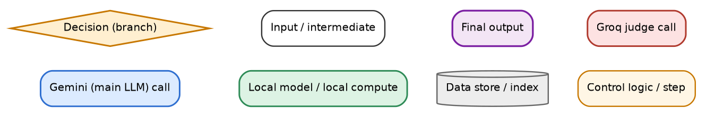

# 1. Scope and framing

## 1.1 What the paper contributes

The paper is a perspectives/survey article with no experiments of its own. It sorts RAG into four paradigms and defines two agent roles (knowledge acquisition: whether / when / what / where to retrieve; knowledge utilization: refine, organize, generate). Section 4 (joint optimization with rewards) and Section 5 (LLM data synthesis and LLM-as-judge evaluation) are additional material. Our project is therefore an empirical comparison that the paper itself does not contain.

## 1.2 Systems to implement (10 + 3 ablation variants)

| ID | Paradigm (paper section) | Frozen-LLM analogue built here | Inspired by |
|---|---|---|---|
| S-1 | Reference (no retrieval) | LLM answers from its own knowledge | parametric-knowledge baseline |
| S0 | Naive RAG (2.1) | dense top-5, concatenate, generate | RAG, REALM, FiD line |
| S1 | Retrieval-centric, pre-retrieval (2.2) | query rewrite + HyDE + RRF fusion | HyDE, Rewrite-Retrieve-Read, DMQR-RAG |
| S2 | Retrieval-centric, post-retrieval (2.2) | hybrid retrieval + rerank + filter + sentence compression | monoBERT, REAR, RECOMP |
| S3 | Retrieval-centric, pre + post (2.2) | decomposition + rerank + filter + compression | Self-Ask, QD-RAG |
| S4 | LLM-centric (2.3) | gate + Chain-of-Note + self-critique + revision | Adaptive-RAG, Chain-of-Note, Self-RAG |
| S5 | Agentic, single-agent (2.4, 3.1) | search-tool reasoning loop with scratchpad | Search-o1, Search-R1 (prompted) |
| S6a | Agentic, multi-agent, acquisition-driven (3.2.1) | decision + query + sufficiency agents | Adaptive-RAG, Auto-RAG |
| S6b | Agentic, multi-agent, utilization-driven (3.2.2) | evaluator + note-taker + generator + reconciler | MAIN-RAG, ThinkNote, AlignRAG |
| S6c | Agentic, multi-agent, hybrid / dynamic (3.2.3) | planner-router + source-restricted retrieval + refiner + decider | HM-RAG, DeepNote, ReSP |
| A1 | ablation | S6c without source routing | isolates routing |
| A2a, A2b | ablation | S2 rerank-only; S2 without compression | isolates post-retrieval steps |

## 1.3 What is deliberately NOT implemented

- Methods that require training or fine-tuning (Self-RAG tokens, Search-R1 / R1-Searcher RL, RA-DIT, REPLUG, ATLAS, RankRAG, MMOA-RAG, DDR, all of paper Section 4). They cannot be trained in one week on free APIs and a laptop CPU. We build training-free, prompt-based analogues of each paradigm's control logic. The report must state: "results describe the paradigm instantiated with a frozen general-purpose LLM, not the published trained models."
- The team's own KAG-FLOW prototype (claim/gap-driven loop). It is a variant of S6c and is listed as future work.
- Memory / long-term retention agents, multimodal retrieval, web search, knowledge graphs. The corpus is text only and static.

# 2. Fixed decisions (single source of truth)

| Item | Decision | Why |
|---|---|---|
| Language / runtime | Python 3.11, plain scripts, pytest | simplest for Copilot; no framework overhead |
| Orchestration | Plain Python classes, no LangChain / LlamaIndex | transparent call and token accounting; every control flow visible |
| Main LLM (all systems, all roles) | Gemini via `google-genai` SDK, Flash-Lite-class model. Default `gemini-2.5-flash-lite`; `scripts/check_models.py` (Task T03) lists the models your key can use and pins the newest `*flash-lite*` id into `config.yaml` if the default is unavailable. Temperature 0. Thinking disabled. | highest free-tier request headroom; this experiment is call-hungry (about 1,000 calls for the test set); adequate JSON / instruction following |
| Judge LLM | Groq `llama-3.3-70b-versatile`, temperature 0, JSON mode | different model family from the main LLM (reduces self-preference bias); free; fast |
| Embedding model | `BAAI/bge-small-en-v1.5` (384-d, ~33M params) via sentence-transformers | strong retrieval quality for its size, fast on CPU, small RAM |
| Vector database | ChromaDB `PersistentClient`, one collection `cve_corpus`, cosine space, metadata filter on `source_type` | embedded (no server); metadata filters give source routing for S6c |
| Sparse retrieval | `rank-bm25` `BM25Okapi`, custom tokenizer that keeps CVE ids and version strings intact | exact-match for identifiers such as `CVE-2024-3400` and `10.2.9-h1` that dense vectors blur |
| Hybrid fusion | Reciprocal Rank Fusion, k = 60 | parameter-light, standard |
| Reranker | `BAAI/bge-reranker-base` cross-encoder, loaded with `transformers` (torch, CPU), sigmoid of logit | large quality gain over bi-encoder; ~1.1 GB RAM; fits 16 GB |
| NLI (evaluation only) | `cross-encoder/nli-deberta-v3-xsmall` | fast local faithfulness check; no API quota |
| Local generative LLM | none | CPU generation is too slow for agent loops and would confound the comparison; local models are non-generative helpers only |
| Chunking | 180 words, 30-word overlap inside a section, min 25 words, header prefix `title - section` | about 250 tokens per chunk; 5 chunks fit the context cap |
| Context cap at generation | 2,000 tokens (estimated as characters / 4) for every system | differences come from evidence selection, not volume |
| Generation prompt | one fixed prompt for every system (Appendix A, P-GEN) | keeps "everything else common" |
| Call budget per question | 8 LLM calls per system; the final generation call is reserved | matched-budget comparison |
| Execution | sequential; one question at a time; results cached on disk | simplest; robust to 429 errors |
| Seeds | 42 everywhere | reproducibility |
| Questions | 40 total: 10 dev (`d01`-`d10`), 30 test (`t01`-`t30`) | dev for prompt debugging and threshold calibration; test for reporting |
| Hardware assumption | 16 GB RAM, 6-core i5 CPU, no GPU | given |

## 2.1 Which local components each system uses

| System | Dense (bge-small + Chroma) | BM25 | Reranker | NLI | Gemini roles (calls before final answer) |
|---|---|---|---|---|---|
| S-1 | no | no | no | no | none |
| S0 | yes, top-5 | no | no | no | none |
| S1 | yes (per query) | yes (per query) | no | no | rewrite + HyDE (1) |
| S2 | yes, top-30 | yes, top-30 | yes | no | none |
| S3 | yes | yes | yes | no | decomposer (1) |
| S4 | yes, top-8 and top-3 | no | no | no | gate, chain-of-note, critique, revise (3-4) |
| S5 | yes (via hybrid tool) | yes | no | no | agent step x up to 5 |
| S6a | yes (hybrid) | yes | no | no | decision, query x3, sufficiency x2 |
| S6b | yes, top-10 | no | no | no | evaluator, note-taker, critic x2, regenerate x2 |
| S6c | yes (hybrid, source-filtered) | yes | yes | no | planner, refiner x3, decider x2 |
| Evaluation | - | - | - | yes | Groq judge |

Hybrid retrieval is deliberately absent from S0, S4 and S6b so that the effect of adding BM25 and reranking is visible in S2 and later systems.

# 3. Repository layout and environment

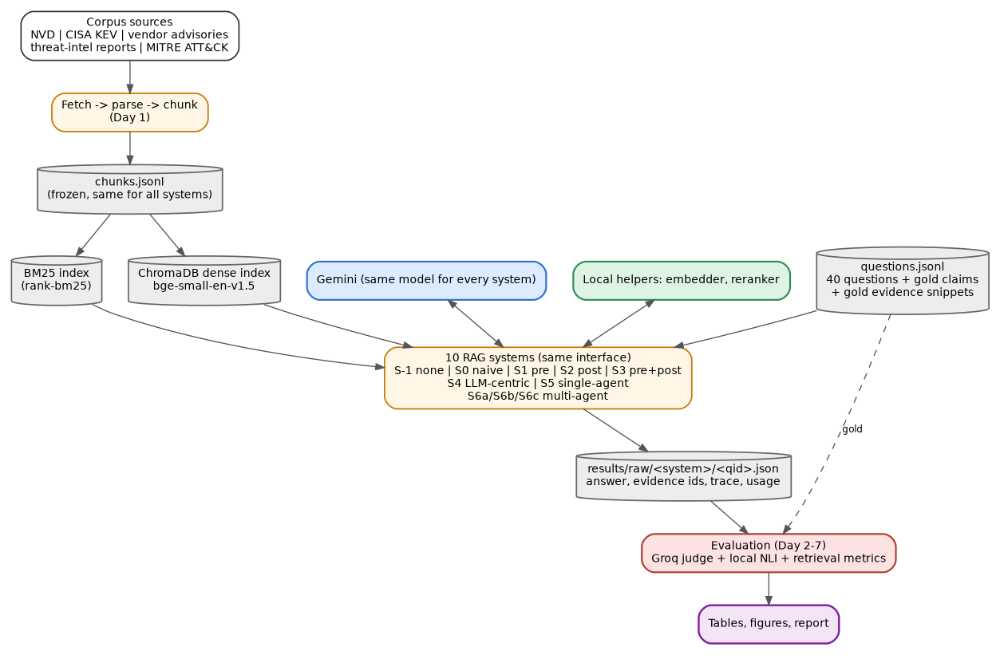

## 3.1 Repository layout

```
rag-compare/
  README.md
  requirements.txt            # lower bounds; then pip freeze > requirements.lock
  .env.example                # GEMINI_API_KEY1= GEMINI_API_KEY2= GEMINI_API_KEY3= GROQ_API_KEY1= GROQ_API_KEY2= GROQ_API_KEY3=
  .gitignore                  # .env, cache/, data/index/, data/raw/_cache/, __pycache__
  config.yaml                 # all parameters (Section 4.2)
  corpus_manifest.yaml        # documents to fetch (Section 5)
  docs/
    IMPLEMENTATION_PLAN.pdf   # the same plan, for reading
    IMPLEMENTATION_PLAN.md    # the same plan; Copilot should read this file
    architecture_diagrams.zip # unzip INSIDE docs/ to create docs/architecture/
    architecture/*.png        # 14 diagrams, referenced by the .md
  data/
    raw/                      # frozen downloads (commit these)
    processed/docs.jsonl
    processed/chunks.jsonl
    index/chroma/             # Chroma persistent dir (not committed)
    index/bm25.pkl
    questions/questions.jsonl
    corpus.lock               # sha256 of each raw file + download date
  src/ragc/
    config.py  schemas.py  util.py
    llm/        base.py gemini_client.py groq_client.py cache.py ratelimit.py keypool.py fake.py
    corpus/     fetch.py parse_nvd.py parse_kev.py parse_html.py parse_attack.py
                chunker.py build_index.py
    retrieval/  embed.py dense.py bm25.py hybrid.py reranker.py
    generation/ prompts.py evidence.py generator.py
    systems/    base.py registry.py s_1_none.py s0_naive.py s1_pre.py s2_post.py
                s3_decomp.py s4_llm_centric.py s5_single_agent.py
                s6a_acquisition.py s6b_utilization.py s6c_hybrid.py post_refine.py
    eval/       make_questions.py validate_questions.py retrieval_metrics.py
                nli_faith.py judge.py listwise.py aggregate.py plots.py
    runner.py
  scripts/      check_models.py fetch_corpus.py build_all.py run_system.py
                run_judge.py run_eval_local.py make_report.py
  tests/        fixtures/mini_chunks.jsonl  test_*.py
  cache/        llm_cache.sqlite            # created at runtime, not committed
  results/      raw/<system>/<qid>.json  judged/  tables/  figures/
```

## 3.2 Environment setup (Day 1, task T01)

```
python -m venv .venv
# activate the venv, then:
pip install torch --index-url https://download.pytorch.org/whl/cpu
pip install "transformers>=4.44" "sentence-transformers>=3.0" "chromadb>=0.5" rank-bm25 \
    google-genai groq trafilatura requests "pydantic>=2" pyyaml numpy pandas matplotlib \
    tqdm pytest python-dotenv
pip freeze > requirements.lock
```

- First run downloads about 1.6 GB of Hugging Face models (bge-small, bge-reranker-base, nli-deberta-v3-xsmall). Run `python scripts/build_all.py --download-models` once on a good connection.
- Set `torch.set_num_threads(6)` at process start. Load the reranker and NLI model lazily so unused models do not occupy RAM. Expected peak RAM is well under 6 GB.
- Do not run two processes that both load the reranker at the same time.

## 3.3 API keys and accounts (Day 1)

Only two keys are needed. Put them in `.env` (copy `.env.example`), never in code or git.

| Key | Where to create it | `.env` name | Used for |
|---|---|---|---|
| Gemini API key | Google AI Studio, `https://aistudio.google.com/apikey` (sign in with a Google account, Create API key) | `GEMINI_API_KEY1`, `GEMINI_API_KEY2`, `GEMINI_API_KEY3` | main LLM for all systems and for question drafting |
| Groq API key | Groq Console, `https://console.groq.com/keys` (free account, Create API Key; the key starts with `gsk_` and is shown once) | `GROQ_API_KEY1`, `GROQ_API_KEY2`, `GROQ_API_KEY3` | judge LLM |

**Several keys.** Free-tier limits belong to the Google Cloud project (Gemini) or the organization (Groq), so a second key inside the same project or account adds nothing. Keys from separate accounts do have separate quotas. If you use them, write them as the numbered variables `GEMINI_API_KEY1`, `GEMINI_API_KEY2`, `GEMINI_API_KEY3` (and the same for Groq). All keys of one provider must use the same model, and the client uses them one after another (Section 4.3, key pool). Check the provider's terms before using several accounts to get around free-tier limits; a suspended account would stop the experiment.

No key is needed for the corpus sources (CISA KEV, MITRE ATT&CK on GitHub, vendor and blog pages) or for the local models on Hugging Face (all three are public). An NVD API key is optional: without one NVD allows 5 requests per 30 seconds, which the fetch script respects with a 7-second pause (13 requests, about 2 minutes).

## 3.4 Corpus and questions at a glance

The corpus is fetched once, frozen in `data/raw/`, and every system reads the same `chunks.jsonl`. Section 5 gives the full corpus definition. Section 10 gives the question set.


# 4. Shared toolkit (built once, used by every system)

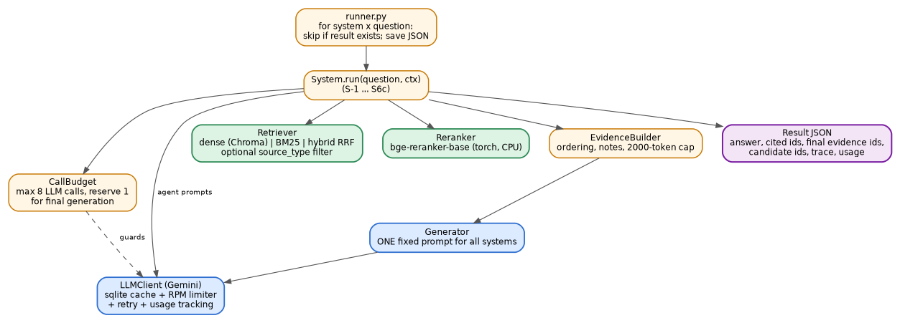

## 4.1 Data schemas (`src/ragc/schemas.py`)

```python
from pydantic import BaseModel, Field

class Chunk(BaseModel):
    chunk_id: str            # "{doc_id}#{ordinal:03d}", e.g. "nvd_CVE-2024-3400#000"
    doc_id: str
    source_type: str         # nvd | kev | vendor | threatintel | attack
    title: str
    section: str
    url: str
    date: str | None = None
    cve_ids: list[str] = []
    header: str              # f"{title} - {section}"
    text: str                # body only
    n_words: int

class Hit(BaseModel):
    chunk_id: str
    score: float
    rank: int                # 1-based
    via: str                 # dense | bm25 | hybrid | rerank | hyde

class EvidenceItem(BaseModel):
    chunk_id: str
    header: str
    text: str                # raw or compressed text actually shown to the generator
    note: str | None = None  # note attached by S4 / S6b / S6c
    source_type: str = ""

class LLMResult(BaseModel):
    text: str
    prompt_tokens: int
    completion_tokens: int
    latency_s: float
    cached: bool

class SystemResult(BaseModel):
    system: str
    qid: str
    question: str
    answer: str
    abstained: bool
    cited_ids: list[str]
    candidate_ids: list[str]           # every chunk retrieved before refinement, any round
    final_evidence: list[EvidenceItem] # exactly what the generator saw
    trace: list[dict] = []             # one dict per step: {"step":..., "calls":..., ...}
    usage: dict = {}                   # llm_calls, prompt_tokens, completion_tokens,
                                       # active_latency_s, local_s, wall_s
    errors: list[str] = []
```

## 4.2 Configuration (`config.yaml`)

```yaml
seed: 42
main_llm:
  provider: gemini
  model: gemini-2.5-flash-lite     # pinned by scripts/check_models.py on Day 1
  temperature: 0
  max_output_tokens_answer: 400
  max_output_tokens_json: 700
  disable_thinking: true
  rpm: 10                          # per key; set to the RPM shown in AI Studio for this model
  rpd_soft: 400                    # per key; the RPD shown in AI Studio, minus a safety margin
judge_llm:
  provider: groq
  model: llama-3.3-70b-versatile
  temperature: 0
  max_output_tokens: 400
  rpm: 25
  tpm: 10000                       # stay under the free-tier tokens-per-minute cap
  tpd_soft: 90000
embedding:
  model: BAAI/bge-small-en-v1.5
  query_prefix: "Represent this sentence for searching relevant passages: "
  batch_size: 32
reranker:
  model: BAAI/bge-reranker-base
  max_length: 384
  batch_size: 16
nli:
  model: cross-encoder/nli-deberta-v3-xsmall
  max_length: 480
chunking: {target_words: 180, overlap_words: 30, min_words: 25}
context: {max_tokens: 2000}          # tokens ~ len(text)/4
budget: {max_llm_calls: 8, reserve_final: 1}
retrieval:
  rrf_k: 60
  s0_k: 5
  s1: {per_query_dense: 10, per_query_bm25: 10, hyde_dense: 10, final_k: 5}
  s2: {dense: 30, bm25: 30, candidates: 30, keep_k: 6}
  s3: {dense: 20, bm25: 20, per_query_k: 10, keep_k: 6, max_subqueries: 3}
  s4: {k: 8, reretrieve_k: 3}
  s5: {dense: 30, bm25: 30, k: 4, max_searches: 4, max_agent_calls: 5}
  s6a: {dense: 30, bm25: 30, k: 5, final_k: 6}
  s6b: {k: 10, min_keep: 2, max_keep: 6, score_threshold: 3, max_regen: 2}
  s6c: {dense: 20, bm25: 20, k_candidates: 15, keep_per_subq: 3, max_rounds: 3, max_subq: 4}
post:                                # shared by S2 and S3
  tau: 0.15                          # PLACEHOLDER; calibrated on dev in task T17, then frozen
  compress_tokens: 1500
paths: {chunks: data/processed/chunks.jsonl, chroma: data/index/chroma,
        bm25: data/index/bm25.pkl, questions: data/questions/questions.jsonl,
        results: results, cache: cache/llm_cache.sqlite}
```

Load it once with `config.py` (`load_config()` returns a nested `SimpleNamespace` or a pydantic model). No other file hard-codes a parameter.

## 4.3 LLM client (`src/ragc/llm/`)

Interface (`base.py`):

```python
class LLM(Protocol):
    def complete(self, system: str, user: str, *, json_mode: bool = False,
                 max_tokens: int = 400, tag: str = "") -> LLMResult: ...
    def json(self, system: str, user: str, *, required: list[str],
             max_tokens: int = 700, tag: str = "") -> dict: ...   # parsed + validated
```

Behaviours that `GeminiClient` and `GroqClient` both implement (shared helpers in `cache.py`, `ratelimit.py`):

1. **Cache.** SQLite table `llm_cache(key TEXT PRIMARY KEY, text TEXT, prompt_tokens INT, completion_tokens INT, latency REAL, ts TEXT)`. Key = sha256 of `provider|model|temperature|json_mode|max_tokens|system|user`. A cache hit returns the stored result with `cached=True`; it still counts as one logical call and its stored token counts are reused for the efficiency metrics (so cached reruns report identical costs) but it consumes no quota.
2. **Rate limiter.** Sliding-window limiter keyed by provider: at most `rpm` requests in any 60 s window (sleep if needed). `GroqClient` also enforces `tpm` using the previous call's reported tokens.
3. **Retries.** On HTTP 429 or 5xx: exponential backoff 2, 4, 8, 16, 32 s (respect a "retry in N s" hint if present); after 5 failures raise `LLMError`.
4. **Daily quota.** If the error text indicates a per-day quota (contains "per day", "PerDay" or "daily"), the key pool (item 9) marks that key exhausted and retries the same request with the next key. Only when every key of the provider is exhausted does the client raise `QuotaExhausted`. The runner catches it, prints a summary, and exits with code 75. The next day the same command continues where it stopped because results and cache persist.
5. **Gemini specifics.** `from google import genai; from google.genai import types`. Call `client.models.generate_content(model=..., contents=user, config=types.GenerateContentConfig(system_instruction=system, temperature=0, max_output_tokens=..., response_mime_type="application/json" if json_mode else None, thinking_config=types.ThinkingConfig(thinking_budget=0)))`. Read `usage_metadata.prompt_token_count` and `candidates_token_count`. If the API rejects `thinking_config` for the pinned model, drop it once, log a warning, and continue.
6. **Groq specifics.** `from groq import Groq; client.chat.completions.create(model=..., messages=[{"role":"system",...},{"role":"user",...}], temperature=0, response_format={"type":"json_object"} if json_mode else None, max_tokens=...)`. Read `usage.prompt_tokens` and `usage.completion_tokens`.
7. **`json()` helper.** Call with `json_mode=True`, strip Markdown fences, `json.loads`, check that all `required` keys exist. On failure retry once with the suffix `"\n\nReturn valid JSON only, no prose."` (a different cache key). On a second failure raise `BadJSON`. Systems catch `BadJSON` and follow the fallback stated in their section.
8. **`FakeLLM` (`fake.py`).** Same interface; constructed with a list of response strings (or a callable `(tag, user) -> str`); records every call in `.calls` (tag, system, user). Used in all unit tests. Token counts = word counts.
9. **Key pool (`keypool.py`).** Reads the numbered variables `GEMINI_API_KEY1`, `GEMINI_API_KEY2`, ... (and `GROQ_API_KEY1`, `GROQ_API_KEY2`, ...) in numeric order, stopping at the first missing number; a plain `GEMINI_API_KEY` / `GROQ_API_KEY` is also accepted as a single key. Sticky failover: use the first key until it reports a daily quota error, then move to the next; never rotate per request. Each key has its own rate limiter (`rpm`, and `tpm` for Groq). Exhausted keys and the time they were marked are stored in `cache/keypool_state.json`; on a new run, a key marked more than 24 hours ago is tried again first. The cache key (item 1) does not include the API key, so results are identical whichever key served them. All keys of a provider must use the pinned model: `scripts/check_models.py` tests every key and stops if any key cannot use it.

## 4.4 Retrieval (`src/ragc/retrieval/`)

**Embeddings (`embed.py`).** `SentenceTransformer("BAAI/bge-small-en-v1.5")`, `encode(texts, batch_size=32, normalize_embeddings=True)`. Documents (chunks and HyDE passages) are embedded as `header + "\n" + text` with no prefix. Queries are embedded as `query_prefix + query`.

**Dense index (`dense.py`).**

```python
class DenseIndex:
    def __init__(self, cfg): ...          # opens Chroma collection "cve_corpus"
    def build(self, chunks: list[Chunk]): ...   # add ids, embeddings, documents, metadatas
    def search(self, query: str, k: int, source_types: list[str] | None = None) -> list[Hit]: ...
    def search_passage(self, passage: str, k: int) -> list[Hit]: ...   # HyDE: no query prefix
```

Chroma details: `collection = client.get_or_create_collection("cve_corpus", metadata={"hnsw:space": "cosine"})`; pass precomputed embeddings; metadata = `{doc_id, source_type, title, section, cve_ids: ",".join(...)}`; filter with `where={"source_type": {"$in": source_types}}` (or `{"source_type": x}` when a single value). Similarity = `1 - distance`.

**BM25 (`bm25.py`).** Tokenizer: lowercase; `re.findall(r"[a-z0-9][a-z0-9._\-]*[a-z0-9]|[a-z0-9]", text)`; this keeps `cve-2024-3400` and `10.2.9-h1` as single tokens. Index text = `header + " " + text`. `BM25Okapi(tokenized_corpus)`, default k1 and b. `search(query, k, source_types=None)` scores all chunks, masks by source type (numpy), returns top-k. Persist with pickle at `data/index/bm25.pkl`.

**Hybrid (`hybrid.py`).**

```python
def rrf(rank_lists: list[list[str]], k: int = 60) -> list[tuple[str, float]]:
    # score(chunk) = sum over lists of 1 / (k + rank); return sorted desc
def hybrid_search(query, k_dense, k_bm25, k_out, source_types=None) -> list[Hit]:
    # dense top k_dense + bm25 top k_bm25 -> rrf -> top k_out; Hit.via = "hybrid"
```

A small `Retriever` facade exposes `dense()`, `bm25()`, `hybrid()`, `passage()`, and `get_chunk(chunk_id)` (dict lookup loaded from `chunks.jsonl`).

## 4.5 Local scoring models (`reranker.py`, `eval/nli_faith.py`)

Use `transformers` directly (stable across versions):

```python
tok = AutoTokenizer.from_pretrained(name)
model = AutoModelForSequenceClassification.from_pretrained(name).eval()
with torch.no_grad():
    enc = tok(queries, passages, padding=True, truncation=True,
              max_length=384, return_tensors="pt")
    logits = model(**enc).logits          # reranker: shape [n, 1]
    scores = torch.sigmoid(logits[:, 0])  # probability-like in [0, 1]
```

- `Reranker.score(pairs: list[tuple[str, str]]) -> list[float]` batches by 16. Passage text for chunks = `header + "\n" + text`.
- NLI wrapper: `entail_prob(premise, hypothesis)` returns softmax probability of the label whose `model.config.id2label[i].lower() == "entailment"` (never hard-code the index).
- Both models are loaded lazily and cached in module-level singletons.

## 4.6 Generation and evidence (`src/ragc/generation/`)

**Evidence block (`evidence.py`).** `build_evidence(items: list[EvidenceItem], max_tokens=2000) -> tuple[str, list[EvidenceItem]]`. Renders each item as

```
[{chunk_id}] ({source_type} | {title} | {section})
{text}
NOTE: {note}            # only when note is set
```

separated by a blank line; when the running total (`len/4`) would exceed the cap, truncate the current item at a sentence boundary, drop the remaining items, and return the items that were actually shown. If the item list is empty, the block is the literal string `(none)`.

**Generator (`generator.py`).**

```python
def generate(llm, question, items, *, extra: str = "", no_evidence_mode: bool = False,
             tag: str = "gen") -> tuple[str, list[EvidenceItem]]:
    # no_evidence_mode=True uses P-GEN-NOEVID (used by S-1 and by "no retrieval" branches)
    # otherwise uses P-GEN. User message =
    #   "Question: {question}\n\nEvidence:\n{block}" + ("\n\n" + extra if extra else "")
```

`extra` is used by S4 (critique feedback) and S6b / S6c (flagged conflicts, critiques). The prompts are in Appendix A (P-GEN, P-GEN-NOEVID). Parse the answer: `abstained = answer.strip().upper().startswith("INSUFFICIENT_EVIDENCE")`; `cited_ids = re.findall(r"\[([^\[\]]+#\d{3})\]", answer)` (unique, in order).

## 4.7 System interface, budget and runner

```python
class CallBudget:
    def __init__(self, max_calls: int, reserve_final: int = 1): ...
    def can_spend(self, n: int = 1) -> bool:   # (used + n) <= max_calls - reserve_final
    def spend(self, n: int = 1): ...           # raises BudgetExceeded if it would break the cap

class System(ABC):
    name: str
    def __init__(self, cfg, llm, retriever, reranker | None): ...
    @abstractmethod
    def run(self, qid: str, question: str) -> SystemResult: ...
```

Rules for all systems:

1. Every agent-role call goes through a helper `self.call_json(tag, system, user, required, budget)` that checks `budget.can_spend()` first, spends, calls `llm.json(...)`, and appends a trace entry. If the budget is exhausted the loop ends and the system proceeds to final generation.
2. The final generation call is made by `generate(...)` and is counted but always allowed (reserve).
3. `candidate_ids` = every chunk id returned by any retrieval call in this run (union, order preserved). `final_evidence` = the items returned by `build_evidence`.
4. `usage` = `{llm_calls, prompt_tokens, completion_tokens, active_latency_s (sum of LLM latencies incl. cached), local_s (time in retrieval + reranker), wall_s}`.
5. A `BadJSON` or `LLMError` inside an agent step appends the message to `errors`, ends the loop, and continues to final generation with whatever evidence exists. A failure in the final generation call gives `answer=""`.

**Runner (`runner.py`, `scripts/run_system.py`).**

```
python scripts/run_system.py --system S2 --split test [--limit 5] [--qids t01,t02] [--max-calls 400]
```

For each question: skip if `results/raw/<system>/<qid>.json` exists; otherwise run, write JSON (`SystemResult.model_dump_json(indent=1)`), print one progress line. On `QuotaExhausted` write nothing for the current question, print a summary and `sys.exit(75)`. `--max-calls` stops cleanly after that many new (uncached) LLM calls. System ids accepted: `S-1, S0, S1, S2, S3, S4, S5, S6a, S6b, S6c, A1, A2a, A2b`.


# 5. Corpus (the shared knowledge base)

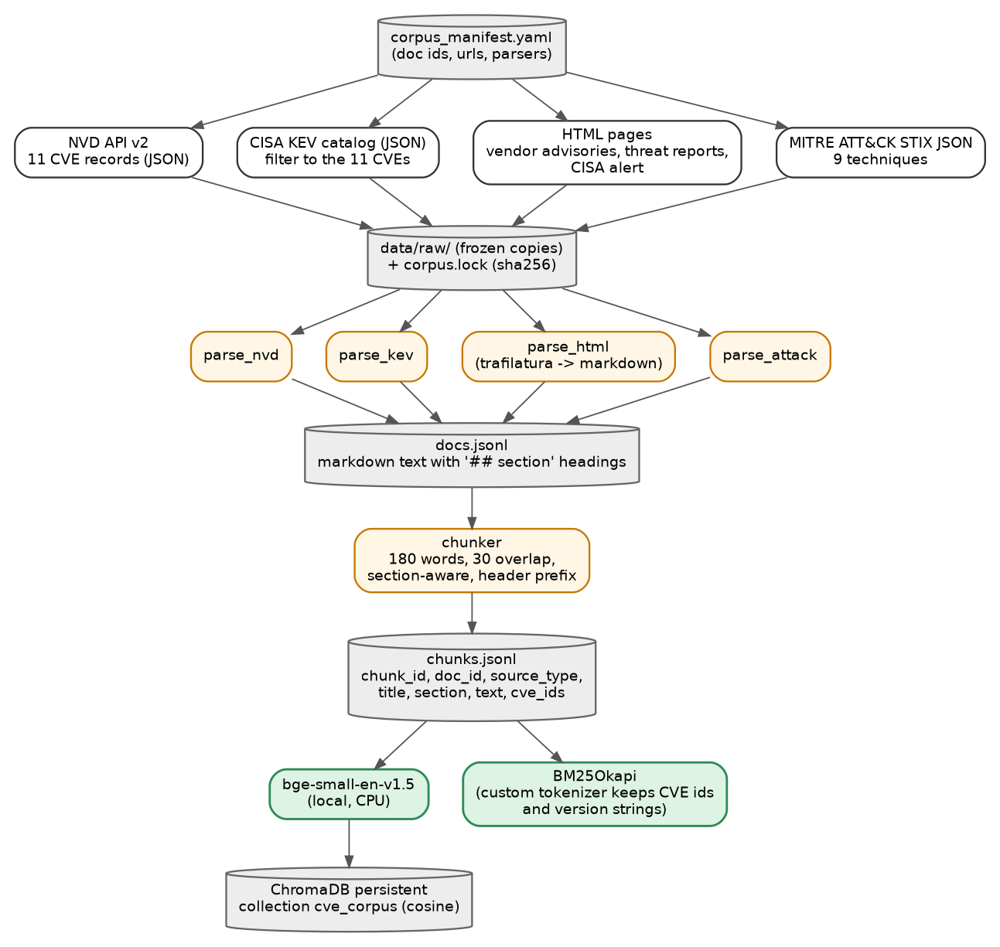

## 5.1 Design decisions

- **Topic.** Vulnerability investigation for CVE-2024-3400 (Palo Alto Networks PAN-OS GlobalProtect command-injection vulnerability), taken from the team's Team3 deck.
- **Why a multi-source corpus.** The paper's agentic systems reason over what to retrieve and where. Five source types with different content (official record, exploitation catalogue, vendor guidance, incident research, technique knowledge base) make routing, multi-hop and cross-source questions natural.
- **Why distractors.** With only one CVE's documents, naive top-5 retrieval would nearly always succeed and the paradigms would look identical. The corpus therefore also contains 12 other CVEs: same-vendor siblings and other edge-device (VPN / firewall) vulnerabilities from 2023-2024 that use similar vocabulary.
- **Frozen snapshot.** Live advisory pages get edited (this matters: vendor guidance on this CVE was updated after first publication). Everything is downloaded once, saved under `data/raw/`, hashed in `data/corpus.lock`, and committed. Nobody re-downloads after Day 1.
- **Size target.** About 55 documents, 350-900 chunks. Small enough that embedding on a CPU takes a few minutes and Chroma / BM25 are instantaneous.

## 5.2 CVE set (13 CVEs)

| Group | CVEs | Role in the study |
|---|---|---|
| Target | CVE-2024-3400 | main subject of most questions |
| Same vendor (PAN-OS family) | CVE-2024-0012, CVE-2024-9474, CVE-2024-3393, CVE-2024-5921, CVE-2024-8686 | confusable siblings (same product, different flaw); some may not be in KEV, which tests correct "not listed" answers |
| Other edge-device vendors | CVE-2024-21887, CVE-2023-46805 (Ivanti); CVE-2024-21762 (Fortinet); CVE-2024-24919 (Check Point); CVE-2024-20353, CVE-2024-20359 (Cisco); CVE-2023-4966 (Citrix) | same vocabulary (VPN, gateway, command injection, zero-day), different facts |

## 5.3 Document inventory (`corpus_manifest.yaml`)

| Source type | `doc_id` pattern | What | How to obtain | Count |
|---|---|---|---|---|
| `nvd` | `nvd_CVE-YYYY-NNNN` | official CVE record: description, CVSS, CWE, affected product / version ranges (CPE), references, dates | NVD API 2.0: `https://services.nvd.nist.gov/rest/json/cves/2.0?cveId=CVE-YYYY-NNNN`; sleep 7 s between requests (unauthenticated limit) | 13 |
| `kev` | `kev_CVE-YYYY-NNNN` | CISA Known Exploited Vulnerabilities entry: vendor / product, name, date added, required action, due date, ransomware-use flag, notes | download `https://www.cisa.gov/sites/default/files/feeds/known_exploited_vulnerabilities.json` once with a browser-like `User-Agent` (CISA has blocked some server IPs; if it fails, use the JSON link on `https://www.cisa.gov/known-exploited-vulnerabilities-catalog` in a browser and save the file as `data/raw/kev.json`); create one doc per CVE that is actually present in the catalogue (absent CVEs get no KEV doc); the parser must ignore fields it does not know, because CISA updated the JSON schema in 2026 | up to 13 |
| `vendor` | `vendor_paloalto_CVE-...` | Palo Alto Networks security advisories | `https://security.paloaltonetworks.com/CVE-YYYY-NNNN` for the 6 PAN-OS CVEs | 6 |
| `vendor` | `vendor_<host>_CVE-...` | one vendor advisory for the other vendors' CVEs | explicit URLs: Check Point `https://support.checkpoint.com/results/sk/sk182336` (CVE-2024-24919); Citrix `https://support.citrix.com/article/CTX579459/` (CVE-2023-4966); Ivanti KB `https://forums.ivanti.com/s/article/KB-CVE-2023-46805-Authentication-Bypass-CVE-2024-21887-Command-Injection-for-Ivanti-Connect-Secure-and-Ivanti-Policy-Secure-Gateways?language=en_US` (covers CVE-2023-46805 and CVE-2024-21887). For Fortinet (CVE-2024-21762, advisory FG-IR-24-015) and Cisco (CVE-2024-20353, CVE-2024-20359): read the NVD JSON `references` and take the first URL tagged "Vendor Advisory", prefer https, skip PDFs. Skip any page whose extracted text is under 300 words | up to 6 |
| `threatintel` | `ti_volexity_cve-2024-3400` | Volexity blog: zero-day exploitation of GlobalProtect (CVE-2024-3400) | `https://www.volexity.com/blog/2024/04/12/zero-day-exploitation-of-unauthenticated-remote-code-execution-vulnerability-in-globalprotect-cve-2024-3400/` | 1 |
| `threatintel` | `ti_unit42_cve-2024-3400` | Unit 42 threat brief on CVE-2024-3400 | `https://unit42.paloaltonetworks.com/cve-2024-3400/` | 1 |
| `threatintel` | `ti_watchtowr_cve-2024-3400` | watchTowr technical analysis | `https://labs.watchtowr.com/palo-alto-putting-the-protecc-in-globalprotect-cve-2024-3400/` (the slug really says "protecc") | 1 |
| `threatintel` | `gov_cisa_cve-2024-3400` | CISA alert on Palo Alto guidance for CVE-2024-3400 | `https://www.cisa.gov/news-events/alerts/2024/04/12/palo-alto-networks-releases-guidance-vulnerability-pan-os-cve-2024-3400` | 1 |
| `threatintel` | `ti_volexity_ivanti` | Volexity report on the two Ivanti Connect Secure zero-days (distractor) | `https://www.volexity.com/blog/2024/01/10/active-exploitation-of-two-zero-day-vulnerabilities-in-ivanti-connect-secure-vpn/` | 1 |
| `threatintel` | `ti_talos_arcanedoor` | Cisco Talos ArcaneDoor report on Cisco ASA (distractor) | `https://blog.talosintelligence.com/arcanedoor-new-espionage-focused-campaign-found-targeting-perimeter-network-devices/` | 1 |
| `threatintel` | `ti_unit42_lunar_peek` | Unit 42 brief on the November 2024 PAN-OS management-interface exploitation (same-vendor distractor) | `https://unit42.paloaltonetworks.com/cve-2024-0012-cve-2024-9474/` | 1 |
| `attack` | `attack_T1190` etc. | MITRE ATT&CK technique entries | download once `https://raw.githubusercontent.com/mitre-attack/attack-stix-data/master/enterprise-attack/enterprise-attack.json` (about 51 MB, so save it in the git-ignored `data/raw/_cache/`); extract T1190, T1133, T1078, T1059.004, T1053.003, T1105, T1041, T1068, T1070.004 into the committed `data/raw/attack_techniques.json` and record the bundle's ATT&CK version in `corpus.lock` | 9 |

**URL verification (web search, 19 September 2026).** Every URL in the table was checked. All resolve to the intended page except one: the watchTowr URL originally had "protection" in the slug and is now corrected to "protecc". The six Palo Alto advisory pages (CVE-2024-3400, -0012, -9474, -3393, -5921, -8686), the Volexity, Unit 42 (both), Talos and CISA pages, the KEV JSON, the NVD API endpoint and the ATT&CK STIX file are confirmed. Pages can still move or change, so Task T06 must re-check them on the day: if a URL fails, fix that URL in the manifest to the page's current address; do not replace it with a different document and do not silently drop it. Acceptance: at least 5 of the 7 threat-intel URLs and at least 4 of the 6 Palo Alto advisory pages are obtained.

**ATT&CK note.** ATT&CK v19 (April 2026) split the Defense Evasion tactic into Stealth and Defense Impairment, and v19.2 followed in August 2026, so tactic names in the extracted text can differ from older write-ups. `parse_attack.py` must skip revoked or deprecated objects and raise a clear error if any wanted technique id resolves to one. T1070.004 (File Deletion) was confirmed to still exist.

**Fetch fallbacks (implemented in `fetch.py`, in this order).** (1) `requests.get` with a browser-like `User-Agent`, then `trafilatura.extract(html, output_format="markdown", include_tables=True, include_comments=False)`. (2) If the extracted text has fewer than 300 words and the page is a Palo Alto advisory, retry the same path on the alternate host `https://securityadvisories.paloaltonetworks.com/CVE-YYYY-NNNN`. (3) If still empty, print `MANUAL: save <url> as data/raw/<doc_id>.html` and continue; the human saves the page from a browser and re-runs the script, which picks up any file already present in `data/raw/`.

## 5.4 Parsers (`src/ragc/corpus/`)

Every parser emits a `Doc` = `{doc_id, source_type, title, url, date, cve_ids, text}` where `text` is Markdown with `## Section` headings. `docs.jsonl` holds one Doc per line.

**`parse_nvd.py`.** From `vulnerabilities[0].cve` build these sections: `## Overview` (CVE id, status, published, last modified, English description), `## Severity` (every CVSS metric present: version, base score, severity, vector string), `## Weakness` (CWE ids), `## Affected products` (one line per `cpeMatch` with `vulnerable = true`: `criteria`, `versionStartIncluding`, `versionStartExcluding`, `versionEndIncluding`, `versionEndExcluding`), `## References` (url + tags). Do NOT include the fields `cisaExploitAdd`, `cisaActionDue`, `cisaRequiredAction`, `cisaVulnerabilityName`: KEV facts must live only in the `kev` source, otherwise source routing would be meaningless.

**`parse_kev.py`.** One doc per CVE: `## KEV entry` with `cveID, vendorProject, product, vulnerabilityName, dateAdded, shortDescription, requiredAction, dueDate, knownRansomwareCampaignUse, notes`. One chunk each.

**`parse_html.py`.** Trafilatura Markdown output; keep headings as `##`; drop navigation / cookie boilerplate lines shorter than 4 words; title from the `<title>` or first heading; date from the page metadata if available.

**`parse_attack.py`.** Load the STIX bundle with `json`. For each wanted technique (`type == "attack-pattern"`, `external_references[].external_id` matches): sections `## Description` (`description`), `## Tactics and platforms` (kill-chain phases, `x_mitre_platforms`), `## Detection` (`x_mitre_detection`), `## Mitigations` (names + descriptions of `course-of-action` objects linked by `relationship` with `relationship_type == "mitigates"`). Remove Markdown citation markers of the form `(Citation: ...)`.

## 5.5 Chunker (`chunker.py`)

Deterministic, same code path for every source.

1. Split `Doc.text` into sections on lines starting with `## ` (text before the first heading is section `Overview`).
2. Within a section, split into paragraphs on blank lines. Greedily pack paragraphs into windows of at most 180 words. A paragraph over 180 words is split at sentence boundaries (`(?<=[.!?])\s+(?=[A-Z0-9])`).
3. Overlap: each window after the first starts with the last 30 words of the previous window (same section only).
4. Merge a final window under 25 words into the previous one.
5. `header = f"{title} - {section}"`; `chunk_id = f"{doc_id}#{ordinal:03d}"` with ordinal counting across the whole document; `cve_ids` = unique regex matches of `CVE-\d{4}-\d{4,7}` in header + text plus the doc's own CVE.
6. Write `chunks.jsonl` sorted by `chunk_id`.

## 5.6 Index build and lock (`build_index.py`, `scripts/build_all.py`)

1. `docs.jsonl` -> `chunks.jsonl`.
2. Embed all chunks with bge-small (batch 32) and add to Chroma (delete and recreate the collection on every build).
3. Build the BM25 index and pickle it.
4. Write `data/corpus.lock` (raw file sha256, download date, chunk count, embedding model name).
5. Print a report: documents per source type, chunks per source type, words per chunk (min / median / max), and, for each of the 13 CVEs, whether a KEV doc exists.

**Acceptance (task T08).** 350-900 chunks; every source type non-empty; `retriever.hybrid("CVE-2024-3400 affected PAN-OS versions", 20, 20, 5)` returns at least one `nvd` or `vendor` chunk of CVE-2024-3400 in the top 5; `retriever.dense("Which ATT&CK technique covers exploiting internet-facing applications?", 5)` returns `attack_T1190` chunks; `retriever.bm25("10.2.9-h1", 5)` returns chunks that literally contain that token (if the vendor advisory was obtained).


# 6. Reference and naive RAG

## 6.1 S-1: No-retrieval baseline

**Purpose.** Measures how much the LLM already knows about these CVEs (parametric leakage; the CVE was published in April 2024). It is the lower reference for every other system.

**Components.** Gemini only.

**Steps.** (1) `generate(llm, question, [], no_evidence_mode=True)` using prompt P-GEN-NOEVID. (2) Return the result with `candidate_ids = []`, `final_evidence = []`.

**Call budget.** 1. **File.** `systems/s_1_none.py`.

## 6.2 S0: Naive RAG (retrieve-and-read)

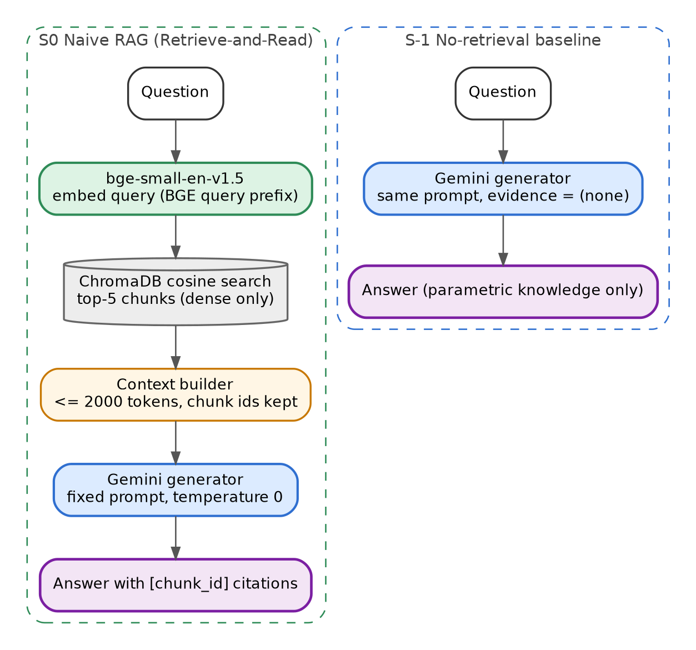

**Paper mapping.** Section 2.1: one retrieval, concatenate documents, generate.

**Components and why.**

| Component | Choice | Why |
|---|---|---|
| Retriever | bge-small + Chroma, dense only | the canonical naive setup; no sparse, no rerank, no LLM help |
| Generator | Gemini, fixed prompt P-GEN | shared |

**Steps.**

1. `hits = retriever.dense(question, k=5)`.
2. `items = [EvidenceItem(chunk_id, header, text, source_type)]` in rank order.
3. `answer, shown = generate(llm, question, items)` (`build_evidence` enforces the 2,000-token cap).
4. `candidate_ids = final ids = the 5 hits`.

**Call budget.** 1 (the generation). **File.** `systems/s0_naive.py`.

**Test (FakeLLM).** With the mini fixture, the system returns exactly 5 evidence items in dense-rank order and makes 1 LLM call.

# 7. Retrieval-centric RAG (S1, S2, S3)

All three keep the LLM out of the control loop: the pipeline is fixed, only the retrieval side is engineered. S1 = pre-retrieval, S2 = post-retrieval, S3 = decomposition (pre) + post-retrieval.

## 7.1 S1: Pre-retrieval (query rewriting + HyDE)

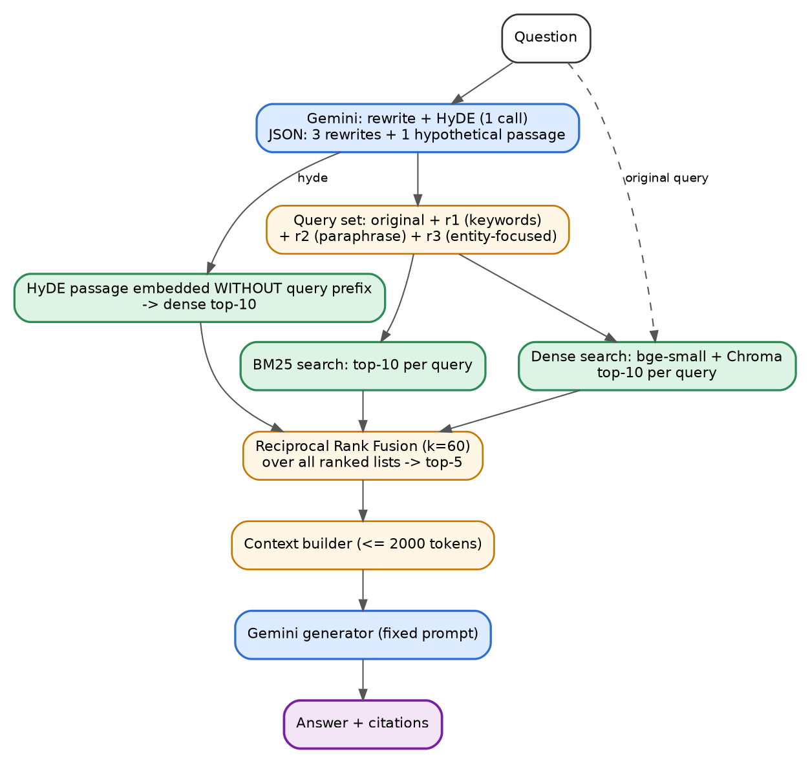

**Paper mapping.** Section 2.2 pre-retrieval: query rewriting (Rewrite-Retrieve-Read, DMQR-RAG) and query expansion / hypothetical documents (HyDE).

**Components and why.**

| Component | Choice | Why |
|---|---|---|
| Rewriter + HyDE | one Gemini JSON call (prompt P-S1-REWRITE) | one call covers both techniques within the call budget |
| Retrievers | bge-small dense and BM25, per query | rewrites in keyword form help BM25; paraphrases help dense |
| Fusion | RRF over all ranked lists | no score calibration needed |

**Steps.**

1. `r = llm.json(P-S1-REWRITE, required=["rewrites","hyde"])`. Use at most 3 rewrites; strip empty strings. On `BadJSON`: log the error and use only the original question.
2. Ranked lists: for each query in `[question] + rewrites`: `dense.search(query, 10)` and `bm25.search(query, 10)`; for `hyde`: `dense.search_passage(hyde, 10)`.
3. `fused = rrf(all_lists, k=60)`; take the top 5 chunk ids.
4. Build evidence in fused order; generate with P-GEN.
5. `candidate_ids` = union of all lists.

**Call budget.** 2. **File.** `systems/s1_pre.py`.

**Test.** FakeLLM returns fixed JSON; assert the number of ranked lists is `2 * (1 + n_rewrites) + 1` and the final evidence length is 5.

## 7.2 Shared post-retrieval refiner (`systems/post_refine.py`)

Used by S2, S3 and ablations A2a / A2b.

```python
def post_refine(reranker, retriever, queries: list[str], candidates: list[str],
                query_of: dict[str, list[str]] | None, cfg,
                *, do_filter=True, do_compress=True) -> list[EvidenceItem]:
```

1. **Score.** For each candidate chunk c, score the pair (q, c) for each q in `query_of[c]` (default: all `queries`). Chunk score = max over those queries. Sort descending; keep the top `keep_k = 6`.
2. **Filter (REAR-style relevance gate).** If `do_filter`: drop chunks with score < `cfg.post.tau`, but always keep the top 2. (`tau` is calibrated once, task T17.)
3. **Compress (RECOMP-extractive).** If `do_compress`: split each kept chunk into sentences with `(?<=[.!?])\s+(?=[A-Z0-9])`, drop sentences under 4 words, score each sentence with the reranker against every query (max), using `header + ": " + sentence` as the passage. Always keep the best sentence of every kept chunk, then add remaining sentences by descending score until the total reaches `compress_tokens = 1500` (chars / 4). Rebuild each chunk's text from its selected sentences in original order, joined with a space, or with " ... " where sentences were skipped. `chunk_id` is preserved so citations stay valid.
4. If `do_compress` is false, return the kept chunks unchanged (still subject to the 2,000-token cap in `build_evidence`).

## 7.3 S2: Post-retrieval (hybrid + rerank + filter + compress)

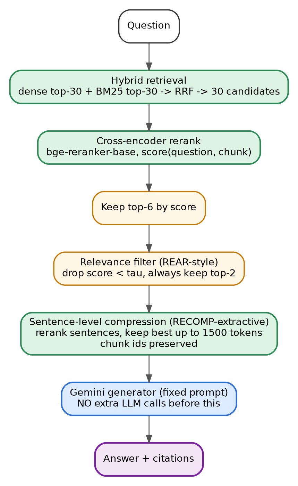

**Paper mapping.** Section 2.2 post-retrieval: reranking (monoBERT-style cross-encoder), filtering (REAR relevance evaluation), compression (RECOMP).

**Components and why.**

| Component | Choice | Why |
|---|---|---|
| Candidate retrieval | dense top-30 + BM25 top-30 -> RRF -> 30 | wide, high-recall candidate set |
| Reranker | bge-reranker-base | cross-encoder reads question and chunk jointly; runs locally, no API cost |
| Filter and compressor | reranker scores on chunks and sentences | keeps everything local; no LLM call before generation |

**Steps.** (1) `cands = retriever.hybrid(question, 30, 30, 30)`. (2) `items = post_refine(reranker, retriever, [question], cands, None, cfg)`. (3) `generate(...)`.

**Call budget.** 1. **File.** `systems/s2_post.py`.

**Ablation variants.** `A2a` = `do_filter=False, do_compress=False` (rerank only, top-5 chunks after the `keep_k` cut, i.e. keep_k = 5); `A2b` = `do_compress=False` (rerank + filter). They are the same class with flags and are registered as separate system ids.

**Test.** With a stub reranker returning scores by chunk id, verify the top-2 are always kept when all scores are below tau, and that compressed evidence is never longer (in characters) than the raw chunks.

## 7.4 S3: Query decomposition + post-retrieval

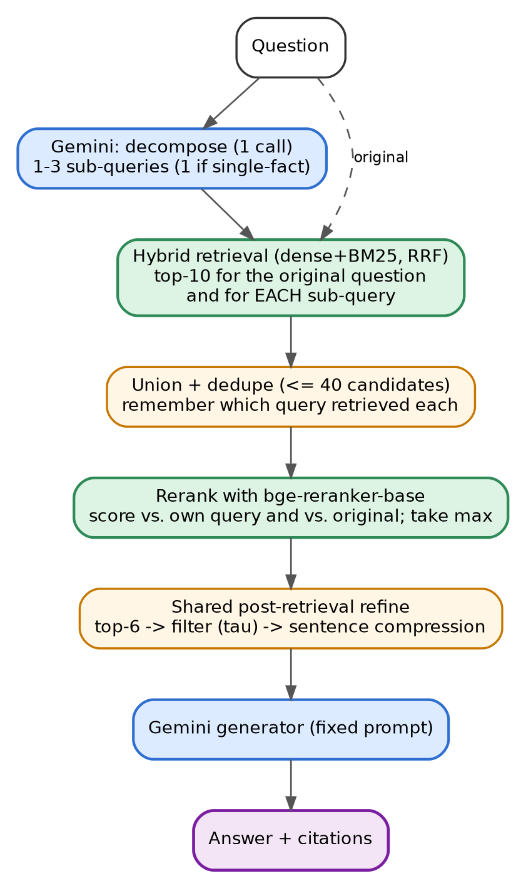

**Paper mapping.** Section 2.2 pre-retrieval decomposition (Self-Ask, QD-RAG) combined with post-retrieval refinement.

**Components and why.** Gemini decomposer (1 call); hybrid retrieval per sub-query; bge-reranker-base to merge and filter candidates coming from different queries on a common scale (a bi-encoder score from different queries is not comparable, a cross-encoder scored against the original question is).

**Steps.**

1. `d = llm.json(P-S3-DECOMP, required=["sub_queries"])`. Keep at most 3 non-empty sub-queries; if the list is empty or `BadJSON`, use `[question]`.
2. For `q_i` in `[question] + sub_queries`: `hybrid(q_i, 20, 20, 10)`. Record `query_of[chunk_id]` = the sub-queries that retrieved it (always add the original question to the list).
3. Union and dedupe (at most 40 candidates).
4. `items = post_refine(reranker, retriever, [question] + sub_queries, candidates, query_of, cfg)` (score = max over the original question and the sub-queries that retrieved the chunk).
5. `generate(...)` with P-GEN.

**Call budget.** 2. **File.** `systems/s3_decomp.py`.

**Latency note.** Worst case is about 80 reranker pairs; on the target CPU this takes seconds to tens of seconds. Latency is a reported metric, not a problem.


# 8. LLM-centric RAG (S4) and single-agent RAG (S5)

## 8.1 S4: LLM-centric RAG

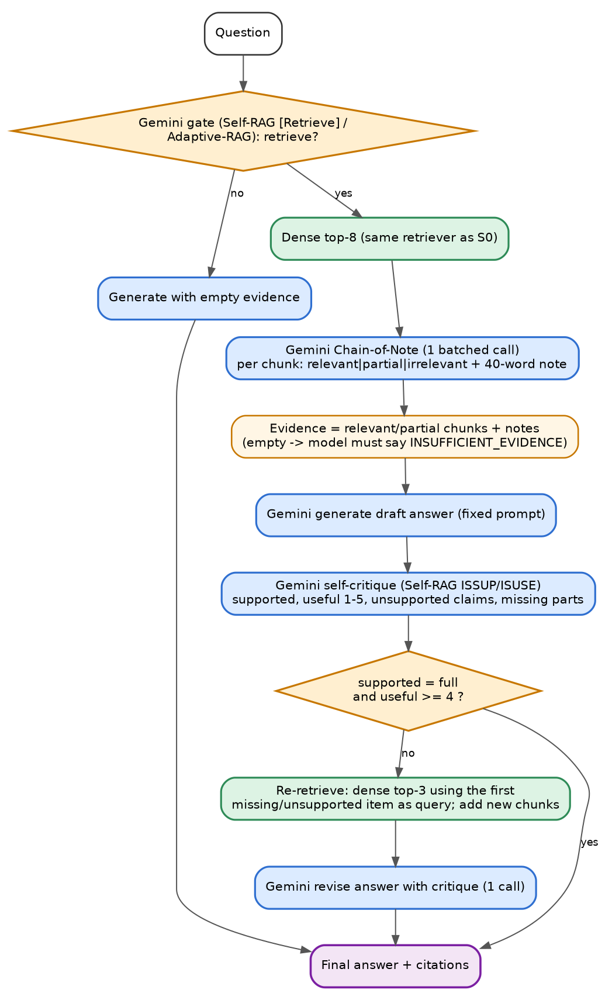

**Paper mapping.** Section 2.3: the LLM is adapted to RAG so that it decides when to retrieve, reads evidence critically and reflects on its own output (Self-RAG reflection tokens, Chain-of-Note, Adaptive-RAG). We cannot fine-tune, so one frozen LLM plays these roles through prompts. The retriever is deliberately the plain S0 retriever so that any gain comes from the LLM's behaviour.

**Components and why.**

| Component | Choice | Why |
|---|---|---|
| Retriever | bge-small + Chroma dense, top-8 (then top-3 for re-retrieval) | identical to S0 apart from k |
| Gate | Gemini call P-S4-GATE | Self-RAG `[Retrieve]` / Adaptive-RAG decision |
| Reader | Gemini call P-S4-NOTES, one batched call | Chain-of-Note: relevance verdict + note per chunk; lets the model discard noise and admit ignorance |
| Reflection | Gemini call P-S4-CRITIQUE | Self-RAG `ISSUP` / `ISUSE` analogue |
| Revision | generation with `extra` feedback | one repair step |

**Steps.**

1. **Gate.** `g = llm.json(P-S4-GATE, required=["retrieve"])`. If `retrieve` is false: `generate(..., no_evidence_mode=True)`, return (log `gate=false`). On `BadJSON` treat as `retrieve=true`.
2. **Retrieve.** `hits = retriever.dense(question, 8)`.
3. **Chain-of-Note.** `n = llm.json(P-S4-NOTES, required=["notes"])` with the 8 chunks (full text). For each chunk: `relevance` in `relevant | partial | irrelevant`, `note` (at most 40 words), `answers_directly` (bool). Evidence = chunks marked `relevant` first, then `partial`, each with its `note`; `irrelevant` chunks are dropped. On `BadJSON`: use all 8 chunks with no notes. If the evidence is empty, the generator receives `(none)` and P-GEN makes it answer `INSUFFICIENT_EVIDENCE` (this is the intended calibrated refusal).
4. **Draft.** `answer1 = generate(...)` with P-GEN.
5. **Critique.** If `answer1` is not an abstention: `c = llm.json(P-S4-CRITIQUE, required=["supported","useful","unsupported_claims","missing_parts"])`. Done (skip to output) when `supported == "full"` and `useful >= 4`. On `BadJSON` skip revision.
6. **Repair.** Query = first item of `missing_parts` (else first of `unsupported_claims`). `new = retriever.dense(query, 3)`; append chunks not already in evidence (no notes). Then `generate(..., extra=P-S4-REVISE-EXTRA with the critique text)`.

**Call budget.** 5 maximum (gate, notes, draft, critique, revise). **File.** `systems/s4_llm_centric.py`.

**Trace fields.** `gate`, `relevance_counts`, `critique`, `revised` (bool).

**Test.** Script FakeLLM to return `retrieve=true`, notes marking 2 of 8 chunks relevant, an answer, a critique with `supported="partial"`, and a revision; assert 5 calls, final evidence contains the re-retrieved chunks, and a second scripted case where all chunks are irrelevant yields evidence `[]`.

## 8.2 S5: Single-agent agentic RAG

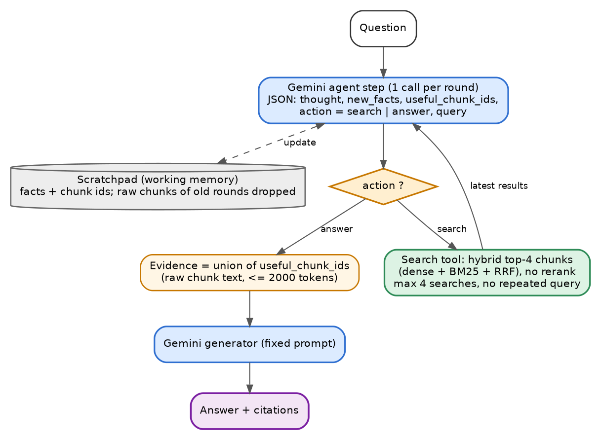

**Paper mapping.** Sections 2.4 and 3.1: one LLM agent reasons and autonomously issues retrieval actions (Search-o1: reason-in-documents; Search-R1 / R1-Searcher are RL-trained, here prompted). One agent, one tool (`search`). No routing (routing is tested only in S6c).

**Components and why.**

| Component | Choice | Why |
|---|---|---|
| Agent | Gemini JSON step, prompt P-S5-AGENT | text-protocol ReAct is portable and easy to log; no native function-calling dependency |
| Tool | hybrid retrieval, dense 30 + BM25 30 -> top-4 | agent-friendly single tool; no reranker so that S5 vs S6c isolates the multi-agent effect |
| Memory | scratchpad of facts with chunk ids | Search-o1's reason-in-documents: raw chunks are read once, distilled into facts, and dropped |

**Steps.**

1. `scratch = []` (list of `{fact, chunk_id}`), `useful = []` (ordered unique chunk ids), `queries = []`, `latest = None`.
2. Loop up to `max_agent_calls = 5`: call the agent with the question, scratchpad, previous queries and the latest search results (full chunk text with ids, empty at the first step). Required keys: `thought, new_facts, useful_chunk_ids, action`; `query` required when `action == "search"`.
3. Add `new_facts` to `scratch`, add `useful_chunk_ids` (only ids that were in `latest`) to `useful`.
4. If `action == "answer"`, stop. If `action == "search"`: reject the query if its normalized form (lowercase, alphanumerics only) equals a previous query, or if 4 searches were already made; in both cases stop. Otherwise run the tool, set `latest`, continue.
5. **Evidence.** Raw text of `useful` chunks in order (cap 2,000 tokens). If `useful` is empty but at least one search happened, use the top-3 chunks of the last search. If no search ever happened, call `generate(..., no_evidence_mode=True)`.
6. `generate(...)` with P-GEN.

**Call budget.** up to 5 agent calls + 1 generation = 6. **File.** `systems/s5_single_agent.py`.

**Trace fields.** one entry per agent step (`thought`, `action`, `query`, `n_facts`), `n_searches`.

**Test.** Script: step 1 search, step 2 search with a duplicate query (must stop), assert 2 agent calls + 1 generation.

# 9. Multi-agent RAG (S6a, S6b, S6c)

The paper (Fig. 3) splits multi-agent RAG into knowledge-acquisition-driven, knowledge-utilization-driven and hybrid systems. Each sub-type is one system. In all three, "agents" are separate prompts with their own role, JSON schema and no shared hidden state other than what the orchestrator passes explicitly. The final answer is always produced by the same fixed generator (P-GEN), acting as the Generation agent.

## 9.1 S6a: Acquisition-driven multi-agent

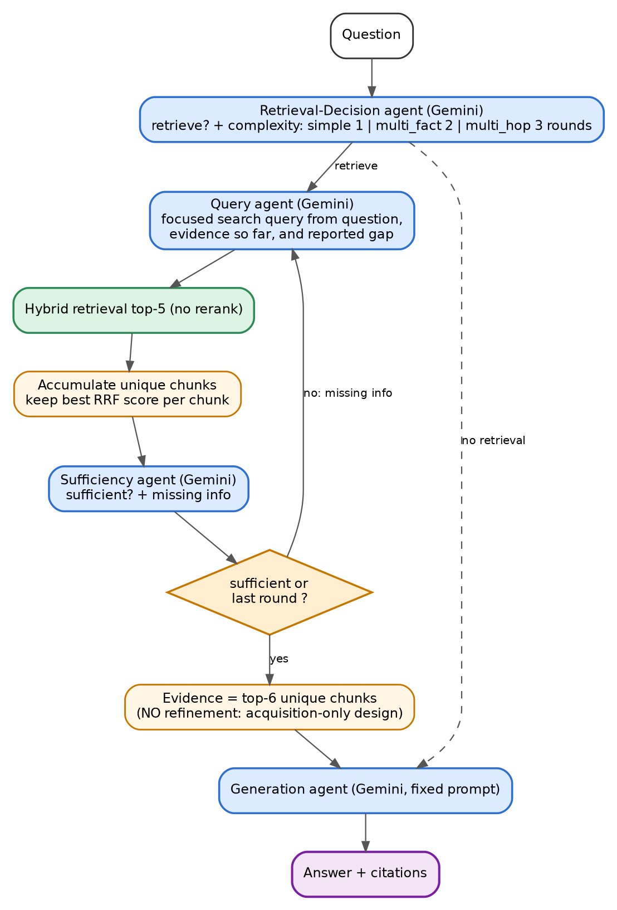

**Paper mapping.** Section 3.2.1: agents decide whether to retrieve, what query to issue and when to stop (Adaptive-RAG, RetrievalQA, Auto-RAG, DMQR-RAG). No evidence refinement: the design focuses on acquiring knowledge.

**Agents.**

| Agent | Prompt | Output JSON |
|---|---|---|
| Retrieval-Decision | P-S6A-DECISION | `{"retrieve": bool, "complexity": "simple"\|"multi_fact"\|"multi_hop"}` |
| Query | P-S6A-QUERY | `{"query": "..."}` |
| Sufficiency | P-S6A-SUFF | `{"sufficient": bool, "missing": "..."}` |
| Generation | P-GEN | plain answer |

**Steps.**

1. Decision agent. If `retrieve` is false: `generate(..., no_evidence_mode=True)`. `max_rounds = {"simple":1, "multi_fact":2, "multi_hop":3}[complexity]` (default 2 on `BadJSON`).
2. For round r in 1..max_rounds: Query agent gets the question, the queries used so far and the `missing` note (empty in round 1); it returns a query (reject duplicates: stop). Retrieve `hybrid(query, 30, 30, 5)`. Accumulate chunks in a dict keeping each chunk's best RRF score.
3. If r < max_rounds: Sufficiency agent sees the question and the accumulated chunks (top 6 by score, text truncated to 600 characters each); if `sufficient`, stop; else pass `missing` to the next round.
4. Evidence = top-6 accumulated chunks by best RRF score, raw text (no refinement). `generate(...)`.

**Call budget.** 1 + 3 x query + 2 x sufficiency + 1 generation = 7 maximum. **File.** `systems/s6a_acquisition.py`.

## 9.2 S6b: Utilization-driven multi-agent

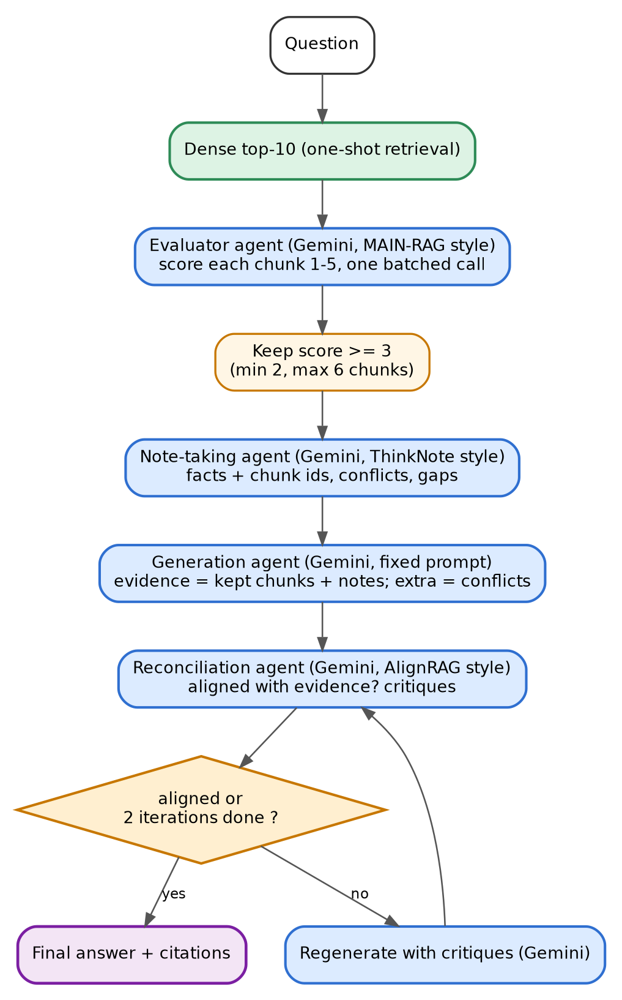

**Paper mapping.** Section 3.2.2: agents refine and organize retrieved knowledge and reconcile it with the generator's reasoning (MAIN-RAG evaluator, ThinkNote assimilation, AlignRAG critique-driven alignment). Retrieval is one-shot.

**Agents.**

| Agent | Prompt | Output JSON |
|---|---|---|
| Evaluator | P-S6B-EVAL | `{"scores":[{"chunk_id","score":1-5,"reason"}]}` |
| Note-taker | P-S6B-NOTES | `{"notes":[{"fact","chunk_ids":[...]}], "conflicts":[{"claim","chunk_ids":[...]}], "gaps":[...]}` |
| Generation | P-GEN with `extra` | answer |
| Reconciliation | P-S6B-RECON | `{"aligned": bool, "critiques":[...]}` |

**Steps.**

1. `hits = retriever.dense(question, 10)`.
2. Evaluator scores all 10 chunks in one call. Keep chunks with `score >= 3`; if fewer than 2 pass, keep the top 2 by score (ties by retrieval rank); keep at most 6.
3. Note-taker reads the kept chunks and returns facts (each with chunk ids), conflicts and gaps. Attach to each kept chunk a `note` = its facts joined with " / ". `extra` = `"Conflicts flagged by the note-taker: ..."` if any conflicts, else empty.
4. `answer = generate(..., extra=extra)`.
5. Reconciliation loop, at most `max_regen = 2` times: call the reconciliation agent with the question, kept chunks and the answer. If `aligned`, stop; else `answer = generate(..., extra=extra + "\nCritiques of the previous draft: " + critiques)`.

**Call budget.** evaluator + notes + draft + 2 x (critic + regenerate) = 7 maximum. **File.** `systems/s6b_utilization.py`.

**Fallbacks.** `BadJSON` in the evaluator: keep the top 5 dense hits. In the note-taker: no notes. In the reconciler: stop the loop.

## 9.3 S6c: Hybrid dynamic multi-agent (acquisition + utilization)

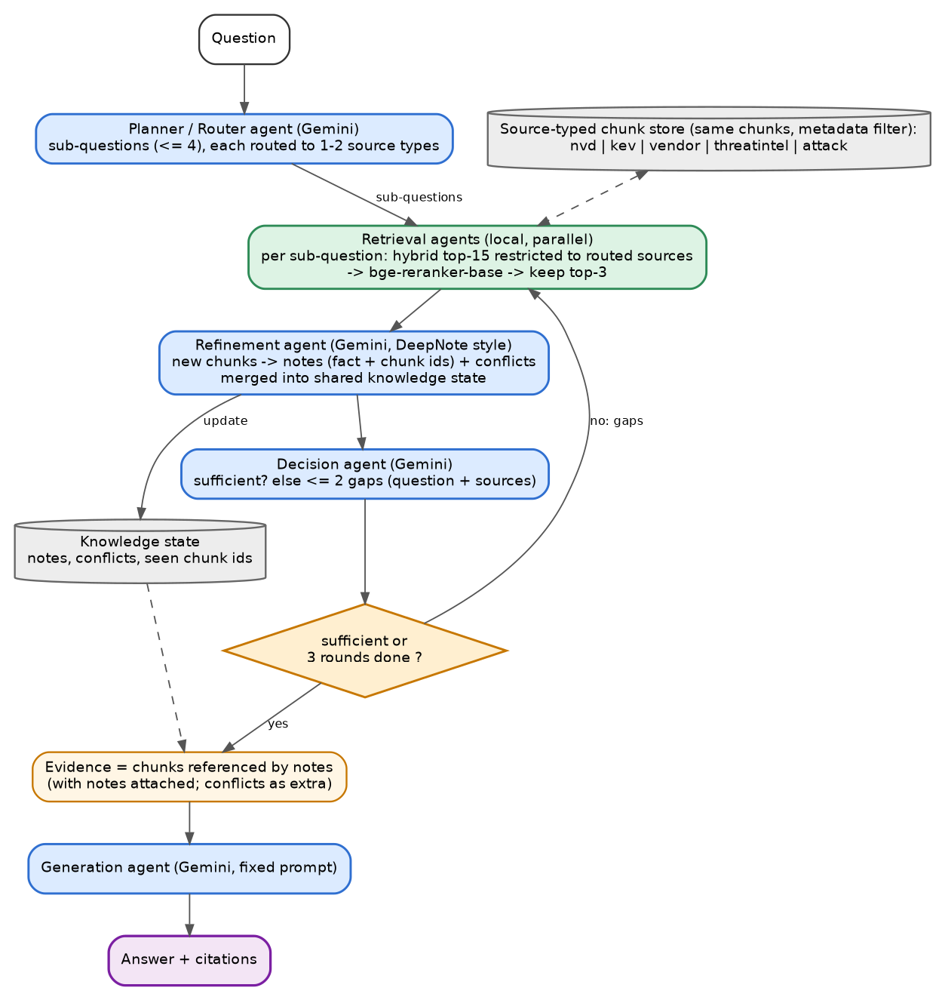

**Paper mapping.** Section 3.2.3: acquisition and utilization agents interact dynamically (HM-RAG decomposer and per-source retrieval agents, DeepNote iterative note refinement, ReSP retrieve-or-answer loop). This is the most complete system and the one closest to the team's KAG-FLOW idea.

**Agents.**

| Agent | Prompt | Output JSON |
|---|---|---|
| Planner / Router | P-S6C-PLAN | `{"sub_questions":[{"id","question","sources":["nvd"\|"kev"\|"vendor"\|"threatintel"\|"attack"]}]}` |
| Retrieval agents (local) | none | per sub-question: hybrid(20, 20, 15) restricted to `sources`, rerank vs the sub-question with bge-reranker-base, keep top 3 not already seen |
| Refinement (DeepNote-style) | P-S6C-REFINE | `{"notes":[{"fact","chunk_ids","sub_question"}], "conflicts":[{"claim","chunk_ids"}]}` |
| Decision | P-S6C-DECIDE | `{"sufficient": bool, "gaps":[{"question","sources":[...]}]}` |
| Generation | P-GEN with `extra` | answer |

**Steps.**

1. Planner returns up to 4 sub-questions, each with 1-2 source types (see the source descriptions in Appendix A, P-S6C-PLAN). On `BadJSON` use one sub-question = the question with no source restriction.
2. Round r in 1..3: for every sub-question run the retrieval agent. If the restricted search returns no chunk, retry once without the source filter and log `route_fallback`. Collect the new chunks (not in `seen`).
3. Refinement agent receives the question, the current knowledge state (notes so far, facts only) and the new chunks grouped by sub-question, and returns notes and conflicts. Merge into `state.notes`, `state.conflicts`, `seen`.
4. If r < 3: Decision agent sees the question and all notes. If `sufficient`, stop; else the next round's sub-questions = `gaps` (at most 2).
5. Evidence = chunks referenced by `chunk_ids` in the notes (raw text, in note order, cap 2,000 tokens), each with its facts as `note`. `extra` = the conflicts, if any. `generate(...)`.
6. Log `routing`: the list of `(sub_question, sources)` for the routing-recall metric.

**Call budget.** planner + 3 x refine + 2 x decide + generation = 7 maximum. **File.** `systems/s6c_hybrid.py`.

**Ablation A1 (`use_routing=False`).** Identical, except the planner is asked for sub-questions without sources (P-S6C-PLAN-NOROUTE) and every retrieval is unrestricted. It isolates the value of source routing.

## 9.4 System registry (`systems/registry.py`)

`get_system(name, cfg, llm, retriever, reranker)` maps `S-1, S0, S1, S2, S3, S4, S5, S6a, S6b, S6c, A1, A2a, A2b` to the classes above (A1 = `S6c(use_routing=False)`, A2a / A2b = `S2` with flags). Systems that do not need the reranker receive `None`.


# 10. Question set

## 10.1 Composition (40 questions, all answerable or deliberately unanswerable from the frozen corpus)

| Type | Code | What it tests | Dev | Test | Authoring |
|---|---|---|---|---|---|
| Single-fact lookup | S | one fact in one chunk (score, date, CWE, version, KEV due date) | 2 | 5 | LLM-drafted, human-verified |
| Multi-claim | M | several facts about one CVE from one or more sources | 2 | 5 | LLM-drafted, human-verified |
| Multi-hop | H | answer requires chaining facts across two documents / sources | 2 | 5 | LLM-drafted, human-verified |
| Cross-source / comparison | X | compare or aggregate over several CVEs or sources | 2 | 5 | LLM-drafted, human-verified |
| Conflict / temporal | C | sources disagree or guidance changed over time | 1 | 5 | written by humans |
| Unanswerable | U | plausible, on-topic, but the corpus does not contain the answer | 1 | 5 | written by humans |

IDs: dev `d01`-`d10` (d01-02 S, d03-04 M, d05-06 H, d07-08 X, d09 C, d10 U). Test `t01`-`t30` in type order, five per type (t01-05 S, t06-10 M, t11-15 H, t16-20 X, t21-25 C, t26-30 U).

Example templates (the human fills in verified content; these show the shape, not facts):

- S: "What CVSS v3.1 base score does NVD list for CVE-2024-3400?"
- M: "For CVE-2024-3400, which PAN-OS versions are affected, is it exploited in the wild, and what remediation does the vendor advise?"
- H: "Find the remediation due date for CVE-2024-3400 in the CISA catalogue, then state which weakness (CWE) NVD assigns to it."
- X: "Which of the Palo Alto CVEs in the collection appear in the CISA KEV catalogue and which do not?"
- C: "Does the current vendor advisory still recommend the mitigation described in the early threat reports? What changed?"
- U: "Which country's government attributed the CVE-2024-3400 exploitation according to the collection?" (only if the corpus really lacks this; verify by keyword search).

## 10.2 Record format (`data/questions/questions.jsonl`)

```json
{"qid": "t07", "split": "test", "type": "multi_claim", "question": "...",
 "answerable": true,
 "gold_answer": "2-4 sentence reference answer written from the documents",
 "gold_claims": [{"id": "c1", "text": "one atomic fact"}, {"id": "c2", "text": "..."}],
 "gold_evidence": [{"doc_id": "nvd_CVE-2024-3400", "snippet": "3-15 word exact substring"}],
 "gold_source_types": ["nvd", "vendor"]}
```

Unanswerable questions: `answerable=false`, `gold_answer="INSUFFICIENT_EVIDENCE"`, empty `gold_claims` and `gold_evidence`, and `gold_source_types` = the sources a reasonable agent would look in.

## 10.3 Authoring workflow (Day 2, task T13)

1. `make_questions.py draft`: for S, M, H, X, sample chunk sets (S: 1 chunk; M: 3 chunks of one CVE across sources; H: 2 chunks from different source types sharing a CVE; X: chunks from 2-3 CVEs of one vendor) and call Gemini with prompt P-Q-DRAFT to draft 12 candidates per type into `data/questions/draft.jsonl`.
2. Humans (all team members, about 2 hours in total) select 7 per type for S, M, H, X, rewrite them so that the question is unambiguous, and complete gold answer, atomic claims, evidence snippets and sources by reading the chunks. They write the 6 C and 6 U questions themselves from the documents.
3. `validate_questions.py` must pass: every `gold_evidence.snippet` occurs (whitespace-normalised, case-insensitive) in a chunk of the stated `doc_id`; every `gold_claim` id is unique; type counts match Section 10.1; `qid` pattern is correct; for `answerable=false` questions, none of the 3 most distinctive question keywords co-occur with an answer-bearing phrase (script prints the top-3 BM25 chunks for a manual last check).
4. Freeze `questions.jsonl`. After freezing, the test questions are not edited. Dev questions may be edited until T17 is done.

Review checklist per question: answerable from one to three chunks; one defensible answer; claims are atomic; no reliance on outside knowledge; no leakage of the answer in the question.

# 11. Evaluation design

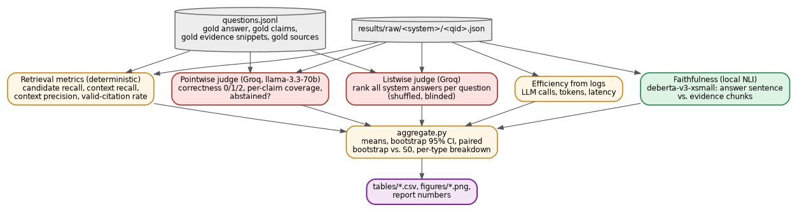

## 11.1 Fairness controls (recap)

Same corpus, chunks, embedder and index; same main LLM at temperature 0; same generation prompt and 2,000-token evidence cap; same call budget (8); test questions untouched during development; judge model from a different family, blind to system names; all runs cached and resumable.

## 11.2 Metrics

| Metric | Definition | Computed by |
|---|---|---|
| Correctness | judge score 0 / 1 / 2 divided by 2, averaged over questions. Unanswerable questions: 2 iff the system abstains | Groq pointwise judge |
| Claim coverage | fraction of gold claims marked covered (answerable questions only) | Groq pointwise judge |
| Faithfulness (proxy) | fraction of answer sentences (at least 6 words, citations removed) entailed by the evidence shown: for each sentence take the max entailment probability over single evidence chunks and, if 2 or more chunks are cited, over the concatenation of the cited chunks (truncated to 480 tokens); supported if at least 0.5. Excluded when the answer abstains | local NLI |
| Contradiction rate | fraction of answers where the judge lists at least one statement contradicting the gold answer | Groq pointwise judge |
| Abstention | `abstained` = starts with `INSUFFICIENT_EVIDENCE` or judge flag. Report abstain rate on U questions (higher is better) and false-abstain rate on answerable questions (lower is better) | regex + judge |
| Candidate recall | fraction of `gold_evidence` snippets found in the text of any chunk in `candidate_ids` | deterministic |
| Context recall | same, over the text of `final_evidence` (after compression) | deterministic |
| Context precision | fraction of `final_evidence` chunks whose `doc_id` is in the question's gold docs | deterministic |
| Valid-citation rate | fraction of cited ids that are in `final_evidence` ids | deterministic |
| Routing recall (S6c, A1 = n/a) | fraction of `gold_source_types` covered by the union of routed sources | deterministic |
| Efficiency | LLM calls, prompt tokens, completion tokens, active latency, local seconds, wall seconds per question | logs |
| Listwise rank | mean rank of the system among the 10 main systems per question (1 = best) | Groq listwise judge |

Retrieval metrics are reported for answerable questions only; S-1 has empty evidence by design.

## 11.3 Judges (Groq `llama-3.3-70b-versatile`, temperature 0)

- **Pointwise (`judge.py`).** One call per (system, question) with prompt P-JUDGE-POINT. Input: question, gold answer, gold claims, candidate answer with citation markers removed. No retrieved context is sent (keeps each call at about 650 tokens so the free daily token budget suffices). Output JSON: `{"correctness":0|1|2, "claims":{"c1":true,...}, "abstained":bool, "contradicts_gold":[...]}`.
- **Listwise (`listwise.py`).** Test set only, main systems only (S-1 to S6c, 10 answers). One call per question with prompt P-JUDGE-LIST, candidates labelled A-J in a shuffled order (seed = 42 + question index), each truncated to 120 words. Output: `{"ranking":["C","A",...]}`. One permutation per question (documented limitation: position bias is reduced by shuffling across questions, not within a question).
- **Quota handling.** `run_judge.py --max-tokens 90000` stops before the daily token cap, stores results in `results/judged/pointwise.jsonl` (append-only, skip existing keys) and exits with code 75 when the provider reports a daily limit. Judge each system's outputs the same day they are generated; expect the complete judging load (about 390 pointwise calls at roughly 650 tokens, plus 30 listwise calls at roughly 2,200 tokens) to be spread over several days.
- **Human audit.** Randomly sample 20 judged answers (seed 42, stratified over systems) and have two people re-grade them; report the agreement rate with the judge in the report. Also spot-check 20 NLI verdicts.

## 11.4 Aggregation (`aggregate.py`)

- Per system: mean of each metric over the 30 test questions; 95% CI by bootstrap over questions (10,000 resamples, seed 42).
- Per question type: the same table split by S / M / H / X / C / U.
- Paired bootstrap of each system against S0 on correctness (difference and 95% CI).
- Efficiency table: mean calls, tokens, latency, and quality per 1,000 tokens (correctness divided by mean total tokens x 1,000).
- Ablation table: A2a vs A2b vs S2; A1 vs S6c.
- Statistical caution to write in the report: with 30 questions, differences under about 10 correctness points are usually inside the confidence interval; state which differences are supported and which are not.

## 11.5 Figures (`plots.py`, matplotlib, saved to `results/figures/`)

1. Bar chart: correctness by system with CI.
2. Heatmap: correctness by system x question type.
3. Scatter: mean total tokens (x) vs correctness (y), one point per system, labelled.
4. Retrieval funnel: candidate recall vs context recall per retrieval-using system.
5. Faithfulness and contradiction rate per system.
6. Boxplot: latency per system (log scale).
7. Abstention: abstain rate on U vs false-abstain rate on answerable questions.

## 11.6 How the report derives "pros and cons with numbers"

For each paradigm, state one measured advantage and one measured cost, each with a number and a figure or table reference. Examples of the pattern (fill with real numbers): "S2 raised context precision from X to Y over S0 at no extra LLM calls but lowered context recall by Z after compression"; "S6c improved correctness on multi-hop questions from X to Y at N times the tokens of S0"; "S4 abstained on k of 5 unanswerable questions but false-abstained on m answerable ones". Add three failure case studies (question, system trace, why it failed).

## 11.7 Report outline

1. Introduction and the paper's taxonomy. 2. Corpus and question set. 3. Systems (one paragraph and one diagram each, with the training-free caveat). 4. Experimental setup and fairness controls. 5. Results: main table, per-type breakdown, efficiency, retrieval funnel, ablations. 6. Failure analysis. 7. Limitations (small corpus, 30 test questions, single LLM, single judge, prompt-based analogues, parametric leakage measured by S-1). 8. Conclusion and future work (KAG-FLOW, trained variants, joint optimization).

## 11.8 API budget and run rules

| System | Max calls / question | Expected average | Calls for 30 test questions |
|---|---|---|---|
| S-1 | 1 | 1 | 30 |
| S0 | 1 | 1 | 30 |
| S1 | 2 | 2 | 60 |
| S2 | 1 | 1 | 30 |
| S3 | 2 | 2 | 60 |
| S4 | 5 | 4.5 | 135 |
| S5 | 6 | 4 | 120 |
| S6a | 7 | 5.5 | 165 |
| S6b | 7 | 6 | 180 |
| S6c | 7 | 6 | 180 |
| A2a + A2b (ablation) | 1 each | 1 | 60 |
| A1 (ablation) | 7 | 6 | 180 |
| Total main + ablations | | | about 1,230 |

Development and reruns add roughly 100 calls per day. These are estimates: replace them with measured averages after the pilot (T16).

**Rules.** (1) Read the RPD shown in AI Studio for the pinned model on Day 1 (for each key) and set `main_llm.rpd_soft` in `config.yaml`. (2) If the RPD summed over all your Gemini keys is below 400, use the `test24` subset for all reported runs: the test set without `t05, t10, t15, t20, t25, t30`. (3) Never run a full-test batch before that system passed its dev sanity check on 3 questions. (4) Debug with `FakeLLM` first; use at most 3 dev questions per real-API debugging iteration.


# 12. Task cards for Copilot (implement in this order)

Each card names the files, the specification (section of this document) and an acceptance test. "Owner" is a suggested split for three people (A = infrastructure, corpus, evaluation; B = S-1 to S4; C = S5 to S6c); with fewer people, merge owners and keep the order.

| ID | Owner | Task | Files | Spec | Acceptance test |
|---|---|---|---|---|---|
| T01 | A | Repo skeleton, venv, requirements, `.env.example`, `.gitignore`, `config.yaml`, `config.py` | repo root, `src/ragc/config.py` | 3, 4.2 | `python -c "from ragc.config import load_config; load_config()"` works; `pytest` runs with zero tests |
| T02 | A | Schemas and utilities: token estimate (`len/4`), sentence splitter, text normaliser, RRF | `schemas.py`, `util.py`, `retrieval/hybrid.py` (rrf only) | 4.1, 4.4 | unit tests for `rrf` (known ranks), sentence splitter keeps `10.2.9-h1` intact |
| T03 | B | LLM layer: cache, rate limiter, key pool, `GeminiClient`, `GroqClient`, `FakeLLM`, `scripts/check_models.py` | `llm/*`, `scripts/check_models.py` | 4.3 | FakeLLM tests; key-pool test (a daily-quota error on key 1 moves the request to key 2, and only when all keys are exhausted `QuotaExhausted` is raised); cache-hit test (second identical call has `cached=True`); `check_models.py` prints the Flash-Lite model ids available to the key and writes the chosen id to `config.yaml`; one real Gemini and one real Groq "say OK" call succeed for every key in `.env` |
| T04 | A | Corpus manifest and `fetch.py` with the three fallbacks and sha256 lock | `corpus_manifest.yaml`, `corpus/fetch.py`, `scripts/fetch_corpus.py` | 5.2, 5.3 | dry-run lists 13 NVD + KEV + advisory + threat-intel + 9 ATT&CK targets |
| T05 | A | Parsers for NVD, KEV, HTML, ATT&CK | `corpus/parse_*.py` | 5.4 | tests on small saved fixtures: NVD parser output has the five sections and no `cisa*` fields; ATT&CK parser strips citations |
| T06 | A | Run the fetch; verify every URL; commit `data/raw/` and `corpus.lock` | `data/raw/*` | 5.3 | at least 5/7 threat-intel and 4/6 Palo Alto pages obtained; report printed |
| T07 | A | Chunker | `corpus/chunker.py` | 5.5 | tests: max 180 words except unsplittable sentences, overlap 30 words, min 25, ids unique, `cve_ids` extracted |
| T08 | A | Index build, BM25, Chroma, `Retriever` facade, `scripts/build_all.py` | `retrieval/*`, `corpus/build_index.py` | 4.4, 5.6 | the acceptance queries in Section 5.6 pass; 350-900 chunks |
| T09 | B | `Reranker` and NLI wrappers | `retrieval/reranker.py`, `eval/nli_faith.py` | 4.5 | reranker scores a relevant pair above an irrelevant pair; NLI returns high entailment for a paraphrase and low for a contradiction; run time for 20 pairs is printed |
| T10 | B | Prompts (Appendix A), evidence builder, generator with citation parsing | `generation/*` | 4.6, App. A | tests: cap enforced, `(none)` when empty, citations parsed, abstention detected |
| T11 | B | `System` base, `CallBudget`, `runner.py`, `scripts/run_system.py` (`--subset test24`), registry | `systems/base.py`, `runner.py`, `systems/registry.py` | 4.7 | runner skips existing results, exits 75 on `QuotaExhausted` (tested with FakeLLM raising it), budget test |
| T12 | B | S-1 and S0 | `systems/s_1_none.py`, `s0_naive.py` | 6 | FakeLLM tests; one real dev question through each system writes a valid result JSON |
| T13 | A | Question tooling and the 40 questions | `eval/make_questions.py`, `eval/validate_questions.py`, `data/questions/questions.jsonl` | 10 | `validate_questions.py` passes; counts match Section 10.1 |
| T14 | A | Retrieval metrics, NLI faithfulness, `scripts/run_eval_local.py` | `eval/retrieval_metrics.py`, `eval/nli_faith.py` | 11.2 | tests on hand-made results; script writes `results/judged/local_metrics.csv` for S0 dev |
| T15 | A | Pointwise judge and `scripts/run_judge.py` (token budget, resume, exit 75) | `eval/judge.py` | 11.3, App. A | FakeLLM test; real judge on 3 S0 dev answers returns valid JSON |
| T16 | A | Pilot: run S-1 and S0 on 3 dev questions end to end, judge them, measure tokens and latency, update Section 11.8 estimates in `README` | - | 11.8 | pilot table (calls, tokens, seconds) saved in `results/pilot.md`; test-size rule decided |
| T17 | B | `post_refine`, S2, A2a, A2b, tau calibration on dev | `systems/post_refine.py`, `s2_post.py` | 7.2, 7.3 | tests from Section 7.3; `scripts/calibrate_tau.py` prints positive-chunk score percentiles, writes `post.tau` = 10th percentile clipped to [0.02, 0.30], then it is frozen |
| T18 | B | S1 | `systems/s1_pre.py` | 7.1 | FakeLLM test from Section 7.1 |
| T19 | B | S3 | `systems/s3_decomp.py` | 7.4 | FakeLLM test: sub-query list drives extra retrieval calls and `query_of` mapping |
| T20 | B | S4 | `systems/s4_llm_centric.py` | 8.1 | scripted tests from Section 8.1 |
| T21 | C | S5 | `systems/s5_single_agent.py` | 8.2 | scripted test from Section 8.2 |
| T22 | C | S6a | `systems/s6a_acquisition.py` | 9.1 | scripted test: `simple` gives 1 round, duplicate query stops the loop, call count at most 7 |
| T23 | C | S6b | `systems/s6b_utilization.py` | 9.2 | scripted test: aligned on first check gives 4 calls; never aligned gives 7 |
| T24 | C | S6c and A1 | `systems/s6c_hybrid.py` | 9.3 | scripted test: routing filter is applied; empty restricted search falls back once; `use_routing=False` sends no filter; at most 7 calls |
| T25 | A | Listwise judge | `eval/listwise.py` | 11.3 | FakeLLM test with a shuffled label mapping recovered correctly |
| T26 | A | Aggregation and plots | `eval/aggregate.py`, `eval/plots.py` | 11.4, 11.5 | runs on a synthetic results folder and writes all tables and figures |
| T27 | A | `make_report.py` (Markdown tables for the report), README (run order), final consistency check (every question has a result for every system) | `scripts/make_report.py`, `README.md` | 11.6 | `python scripts/make_report.py` writes `results/tables/*.md`; consistency check prints zero missing files |

# 13. Seven-day schedule

| Day | Implement | Real-API runs (test set unless noted) | Exit criteria |
|---|---|---|---|
| 1 | T01-T08 (A); T03 (B) | none | corpus frozen, `chunks.jsonl` built, indexes built, retrieval acceptance queries pass, Gemini + Groq keys verified, model id pinned |
| 2 | T09-T16 | pilot only: S-1 and S0 on 3 dev questions | 40 validated questions, generator and runner work, local metrics and judge work, pilot numbers recorded, test-size rule decided |
| 3 | T17, T18, T19 | S-1, S0, S1, S2, S3 (about 210 calls); judge them | S2 tau frozen; five systems fully run; first judged results |
| 4 | T20, T21 | S4 (about 135 calls) and S5 (about 120); judge | S4 and S5 fully run |
| 5 | T22, T23 (T24 started by C) | S6a (about 165) and A2a / A2b (about 60); judge | S6a and A2 done; S6b passes dev sanity |
| 6 | T24, T25 | S6b (about 180) and S6c (about 180); local metrics for all systems; judge | all 10 systems complete; every result file present |
| 7 | T26, T27 | A1 (about 180); listwise judge; final judge pass; human audit of 20 answers | tables and figures generated; report written; buffer for reruns |

**Daily routine.** Morning: run the system scheduled for the day in the background (`python scripts/run_system.py --system S4 --split test`); if it exits with code 75, rerun after the quota resets. Afternoon: implement the next system with FakeLLM tests. Evening: `python scripts/run_judge.py --max-tokens 90000` and `python scripts/run_eval_local.py`.

**Cut order if behind schedule (decided now, not on the day).** (1) drop A1, (2) drop the listwise judge, (3) drop A2a / A2b, (4) drop S6a. Never cut S-1, S0, S2, S4, S5, S6c or the pointwise judge.

# 14. Risks and mitigations

| Risk | Effect | Mitigation (already in the design) |
|---|---|---|
| Free-tier RPM / RPD limits | runs stall | cache, rate limiter, resumable runner, exit code 75, `test24` subset rule, judge token budget |
| JSON parse failures in agent steps | broken loops | one automatic retry, per-system fallbacks, errors counted in results |
| Endless agent loops | quota burn | hard caps: 8 calls, round limits, duplicate-query stop, reserved final call |
| Model already knows the CVE | retrieval looks unnecessary | S-1 baseline quantifies it; questions ask for exact details (versions, dates, ids) and include unanswerable ones |
| Judge bias or error | wrong ranking of systems | judge from a different family, blind and shuffled, gold claims supplied, human audit of 20 answers |
| Small test set (30) | wide confidence intervals | bootstrap CIs, cautious wording, per-type tables, no claims beyond the data |
| Web pages changed or unreachable | corpus differs from plan | frozen raw snapshot, lock file, manual save fallback, acceptance thresholds |
| CPU too slow for reranking | long runs | reranker max length 384, batch 16, at most about 80 pairs per question, latency reported |
| Prompt-based analogues are not the published methods | validity | stated in Section 1.3 and in the report's limitations |
| Time overrun | missing systems | fixed cut order in Section 13 |


# Appendix A. Prompts (copy exactly into `generation/prompts.py`; agent prompts return JSON only)

Prompts are Python string constants. Placeholders in braces are filled with `str.format` or f-strings (escape literal JSON braces accordingly). The source descriptions below are reused wherever a prompt says `{SOURCE_GUIDE}`.

```
SOURCE_GUIDE =
- nvd: NIST NVD records: official description, CVSS scores and vectors, CWE, affected product and version ranges, references, dates.
- kev: CISA Known Exploited Vulnerabilities entries: exploited in the wild, date added, required action, due date, ransomware-use flag.
- vendor: vendor security advisories: affected and fixed versions, workarounds, mitigations, product conditions, advisory updates.
- threatintel: incident and threat research and government alerts: exploitation activity, attacker behaviour, indicators, post-exploitation, detection guidance.
- attack: MITRE ATT&CK technique descriptions, tactics, platforms, detection, mitigations.
```

## A.1 Generation (all systems)

```
P-GEN (system):
You are a cybersecurity analyst assistant. Answer the question using ONLY the evidence items provided.
Rules:
1. End every factual statement with its supporting citation(s) in the form [chunk_id], copying ids exactly as given.
2. Cover every part of the question that the evidence supports (for example versions, exploitation status, behaviour, mitigation).
3. If evidence items conflict, state both versions with their citations and say which source is more recent or more authoritative.
4. If the evidence does not support part of the question, name that part as unsupported. If nothing in the evidence answers the question, reply exactly: INSUFFICIENT_EVIDENCE
5. Maximum 180 words. No preamble, no closing remarks.

P-GEN (user):
Question: {question}

Evidence:
{evidence_block}
{extra_block}
```

```
P-GEN-NOEVID (system):
You are a cybersecurity analyst assistant. No documents are available; answer from your own knowledge.
Rules: Maximum 180 words, no preamble. If you are not sure of a specific fact (version numbers, dates, scores, identifiers), do not guess. If you cannot reliably answer any part of the question, reply exactly: INSUFFICIENT_EVIDENCE. Otherwise answer only the parts you are sure of and say which parts you cannot answer.

P-GEN-NOEVID (user):
Question: {question}
```

## A.2 Retrieval-centric prompts (S1, S3)

```
P-S1-REWRITE (system):
You rewrite search queries for a collection of cybersecurity documents. Sources:
{SOURCE_GUIDE}
Output JSON only.

P-S1-REWRITE (user):
Question: {question}
Return {"rewrites": [r1, r2, r3], "hyde": "..."} where
- r1 is a keyword-style query (product names, CVE ids, version strings, technical terms),
- r2 is a natural-language paraphrase of the question,
- r3 focuses on the single most specific entity or attribute the question asks about,
- hyde is a 60-90 word passage written like an excerpt from an advisory or report that would answer the question.
Do not invent CVE ids that are not in the question.
```

```
P-S3-DECOMP (system):
You decompose questions about cybersecurity vulnerabilities for a document collection. Sources:
{SOURCE_GUIDE}
Output JSON only.

P-S3-DECOMP (user):
Question: {question}
Return {"sub_queries": [...]} with 1 to 3 self-contained search queries that together cover every part of the question. If the question asks for a single fact, return exactly one sub-query equal to the question. Name the CVE id or product in each sub-query whenever the question does.
```

## A.3 LLM-centric prompts (S4)

```
P-S4-GATE (system):
You decide whether answering a question requires searching a fixed collection of documents about specific CVEs. Sources:
{SOURCE_GUIDE}
Output JSON only.

P-S4-GATE (user):
Question: {question}
Return {"retrieve": true|false, "reason": "<=20 words"}. Answer false ONLY for generic questions that do not depend on specific documents.
```

```
P-S4-NOTES (system):
You read retrieved passages critically before answering (Chain-of-Note). Output JSON only.

P-S4-NOTES (user):
Question: {question}

Passages:
{passages_with_ids}

Return {"notes": [...]} with ONE object for EVERY passage:
{"chunk_id": "...", "relevance": "relevant|partial|irrelevant", "note": "<=40 words: the facts in this passage that bear on the question, copying numbers, versions and dates exactly; empty if irrelevant", "answers_directly": true|false}
A passage is irrelevant if it concerns a different CVE, product or topic than the question asks about. Use only the passages.
```

```
P-S4-CRITIQUE (system):
You audit a draft answer against its evidence (Self-RAG style reflection). Output JSON only.

P-S4-CRITIQUE (user):
Question: {question}

Evidence:
{evidence_block}

Draft answer:
{answer}

Return {"supported": "full|partial|none", "useful": 1-5, "unsupported_claims": [...], "missing_parts": [...]}.
supported=full only if every factual statement is backed by the evidence. useful rates how completely the answer addresses the question (5 = fully). At most 3 items per list.

P-S4-REVISE-EXTRA (passed as `extra` to the generator):
Reviewer feedback on your previous draft. Unsupported claims: {unsupported}. Missing parts: {missing}. Rewrite the answer using ONLY the evidence above: remove unsupported claims and cover the missing parts if the evidence allows.
```

## A.4 Single-agent prompt (S5)

```
P-S5-AGENT (system):
You are a research agent investigating a cybersecurity question with a search tool over a fixed document collection. You can only learn about the documents through search results. Sources:
{SOURCE_GUIDE}
Output JSON only.

P-S5-AGENT (user):
Question: {question}

Scratchpad (facts gathered so far, with chunk ids):
{scratchpad_or_(empty)}

Previous search queries: {previous_queries_or_(none)}

Latest search results:
{latest_results_or_(none yet)}

Return {"thought": "...", "new_facts": [{"fact": "...", "chunk_id": "..."}], "useful_chunk_ids": ["..."], "action": "search|answer", "query": "..."}
- thought: one or two sentences on what is known and what is missing.
- new_facts and useful_chunk_ids come ONLY from the latest search results; copy numbers, versions and dates exactly.
- action = "search" with a NEW query (different from previous ones) if a needed part of the question is still missing; action = "answer" when the scratchpad covers every part of the question or more searching is unlikely to help.
- query is required only when action = "search".
```

## A.5 Multi-agent prompts (S6a, S6b, S6c)

```
P-S6A-DECISION (system): You are the Retrieval-Decision agent. Sources: {SOURCE_GUIDE} Output JSON only.
P-S6A-DECISION (user):
Question: {question}
Return {"retrieve": true|false, "complexity": "simple|multi_fact|multi_hop"}.
retrieve=false only for generic questions that need no specific document. simple = one fact in one document; multi_fact = several facts about one entity; multi_hop = facts must be chained across documents or entities.

P-S6A-QUERY (system): You are the Query agent. You write one focused search query for a document collection. Sources: {SOURCE_GUIDE} Output JSON only.
P-S6A-QUERY (user):
Question: {question}
Queries already used: {queries_or_(none)}
Information still missing: {missing_or_(nothing reported; this is the first round)}
Return {"query": "..."}: a new, specific query (include CVE ids, product names or version strings when relevant) that targets the missing information, or, in the first round, the most useful query for the question.

P-S6A-SUFF (system): You are the Sufficiency agent. You judge whether retrieved evidence is enough to answer a question completely. Output JSON only.
P-S6A-SUFF (user):
Question: {question}
Evidence so far:
{evidence_snippets_with_ids}
Return {"sufficient": true|false, "missing": "what specific information is still missing, or empty"}.
```

```
P-S6B-EVAL (system): You are the Evaluator agent. You rate how useful each retrieved passage is for answering a question. Output JSON only.
P-S6B-EVAL (user):
Question: {question}
Passages:
{passages_with_ids}
Return {"scores": [{"chunk_id": "...", "score": 1-5, "reason": "<=15 words"}]} with one entry per passage. 5 = directly contains needed facts; 3 = related and partly useful; 1 = irrelevant (for example a different CVE or product).

P-S6B-NOTES (system): You are the Note-taking agent. You assimilate passages into structured knowledge notes. Output JSON only.
P-S6B-NOTES (user):
Question: {question}
Passages:
{kept_passages_with_ids}
Return {"notes": [{"fact": "...", "chunk_ids": ["..."]}], "conflicts": [{"claim": "...", "chunk_ids": ["...", "..."]}], "gaps": ["..."]}.
Facts must be atomic and copy numbers, versions and dates exactly. A conflict is two passages that disagree; list the claim and both chunk ids. gaps are parts of the question no passage covers.

P-S6B-RECON (system): You are the Reconciliation agent. You check whether an answer is aligned with the evidence and complete. Output JSON only.
P-S6B-RECON (user):
Question: {question}
Evidence:
{evidence_block}
Answer:
{answer}
Return {"aligned": true|false, "critiques": ["..."]}. aligned=false if any statement is unsupported or contradicts the evidence, a supported part of the question is missing, or a flagged conflict is ignored. At most 3 critiques, each specific and actionable.
```

```
P-S6C-PLAN (system):
You are the Planner and Router agent. You break a question into sub-questions and route each to the source types most likely to answer it. Source types:
{SOURCE_GUIDE}
Output JSON only.

P-S6C-PLAN (user):
Question: {question}
Return {"sub_questions": [{"id": "s1", "question": "...", "sources": ["vendor"]}]} with 1 to 4 self-contained sub-questions. Each names the CVE id or product it concerns and has 1 or 2 source types from: nvd, kev, vendor, threatintel, attack.

P-S6C-PLAN-NOROUTE: identical, but the schema is {"sub_questions": [{"id": "s1", "question": "..."}]} and the source guide is omitted (ablation A1).

P-S6C-REFINE (system): You are the Refinement agent. You turn newly retrieved passages into notes and merge them into a shared knowledge state. Output JSON only.
P-S6C-REFINE (user):
Question: {question}
Knowledge notes so far (facts only): {existing_facts_or_(none)}
New passages grouped by sub-question:
{grouped_passages_with_ids}
Return {"notes": [{"fact": "...", "chunk_ids": ["..."], "sub_question": "s1"}], "conflicts": [{"claim": "...", "chunk_ids": ["...", "..."]}]}. Add only NEW atomic facts that help answer the question; copy numbers, versions and dates exactly; flag disagreements between passages (for example an early report vs a later advisory).

P-S6C-DECIDE (system): You are the Decision agent. You decide whether the collected notes answer the question completely. Output JSON only.
P-S6C-DECIDE (user):
Question: {question}
Notes:
{all_notes}
Return {"sufficient": true|false, "gaps": [{"question": "...", "sources": ["..."]}]}. If not sufficient, list at most 2 specific gaps as self-contained sub-questions, each with 1 or 2 source types from: nvd, kev, vendor, threatintel, attack.
```

## A.6 Question drafting and judging prompts

```
P-Q-DRAFT (system): You write evaluation questions for a retrieval-augmented QA benchmark about cybersecurity vulnerabilities. Output JSON only.
P-Q-DRAFT (user):
Question type: {type_description}
Passages (each with id):
{passages_with_ids}
Write {n} candidate questions that can be answered ONLY from these passages and need a specific fact (a number, version, date, identifier or named mitigation), not general knowledge. For each give: question, gold_answer (2-4 sentences), gold_claims (atomic facts), evidence (chunk_id plus an exact 3-15 word snippet copied from the passage). Return {"items": [...]}.

P-JUDGE-POINT (system):
You are a strict grader of answers to cybersecurity questions. Judge ONLY against the gold answer and gold claims; do not use outside knowledge. Ignore citation markers. Output JSON only.

P-JUDGE-POINT (user):
Question: {question}
Gold answer: {gold_answer}
Gold claims:
{claims_lines}
Candidate answer:
{answer}

Return {"correctness": 0|1|2, "claims": {"c1": true|false, ...}, "abstained": true|false, "contradicts_gold": ["short phrase", ...]}.
correctness: 2 = every key gold fact is present and correct and nothing contradicts the gold answer; 1 = partially correct or incomplete, no contradiction; 0 = wrong, contradicting, empty, or refused although the gold answer is not INSUFFICIENT_EVIDENCE.
If the gold answer is INSUFFICIENT_EVIDENCE: correctness = 2 only if the candidate states that the answer cannot be determined (or replies INSUFFICIENT_EVIDENCE) without asserting an answer; otherwise 0, and "claims" is {}.
"abstained" is true if the candidate declines to answer or says the information is not available.

P-JUDGE-LIST (system):
You rank candidate answers to a cybersecurity question. Judge against the gold answer and gold claims only. Output JSON only.

P-JUDGE-LIST (user):
Question: {question}
Gold answer: {gold_answer}
Gold claims:
{claims_lines}
Candidates:
A: {answer_A}
B: {answer_B}
(one line per candidate, labels A to J)
Rank all candidates from best to worst by (1) correctness against the gold answer, (2) completeness of the gold claims, (3) absence of incorrect or unsupported statements. Candidates that refuse are best only if the gold answer is INSUFFICIENT_EVIDENCE. Return {"ranking": ["C", "A", ...]} containing every label exactly once.
```

# Appendix B. Contents for `.github/copilot-instructions.md`

Create this file in the repo so that Copilot applies it to every request:

```
Project: academic comparison of RAG paradigms (see docs/IMPLEMENTATION_PLAN.md).
- The plan is authoritative. Do not change models, libraries, parameters, prompts or file names.
- Python 3.11, package src/ragc, tests in tests/ with pytest. No async, no web frameworks.
- All LLM calls go through ragc.llm clients (cache, rate limit, retries). Never call an SDK directly elsewhere.
- Every system implements System.run(qid, question) -> SystemResult and respects CallBudget (8 calls, 1 reserved for final generation).
- Write unit tests using FakeLLM before running anything against the real APIs.
- Runs are resumable: never delete results/ or cache/ unless asked.
- Read keys from .env as numbered variables (GEMINI_API_KEY1..N, GROQ_API_KEY1..N); never print them, commit them, or write them into logs or result files.
- Keep code simple and commented; this is an academic prototype, not production.
```

# Appendix C. Glossary

- **RRF**: reciprocal rank fusion, `score = sum 1/(60 + rank)` over ranked lists.
- **HyDE**: retrieve with the embedding of an LLM-written hypothetical answer passage.
- **REAR / RECOMP**: relevance-aware filtering / extractive-abstractive compression of retrieved text (here approximated with the local reranker).
- **Chain-of-Note**: the reader writes a short note per retrieved passage before answering, so it can discard noise and admit ignorance.
- **KEV**: CISA Known Exploited Vulnerabilities catalogue.
- **Parametric leakage**: the LLM answers from its training data rather than from retrieved documents; measured by S-1.
- **Candidate recall / context recall**: gold evidence present before / after refinement.
